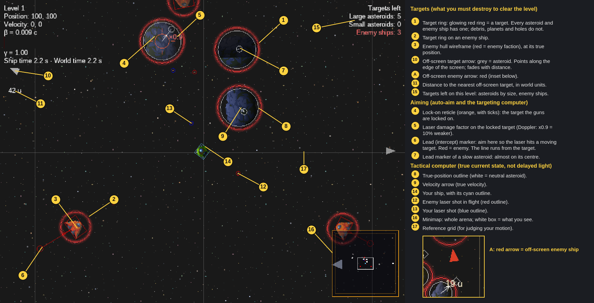

# Star Trap: Game Design Document

> Living document. The owner's raw wishes live in [todo.md](todo.md). This file turns them into a coherent design. Physics details are in [../research/relativity-effects.md](../research/relativity-effects.md), and implementation work is in [../backlog.md](../backlog.md).

## 1. Pitch

**Asteroids meets Einstein.** You fly a top-down, physics-driven ship in an arena where **the speed of light is slow**: tens of world units per second instead of 300 000 km/s. Engines are absurdly powerful, so a ship gets close to *c* within seconds. From then on, relativity takes over gameplay and visuals. Mass-energy grows, time runs differently for you than for your enemies, the starfield bunches up ahead and shifts blue, and black holes bend light and trajectories around them.

The long-term aim is an **action roguelike**, in the vein of Nova Drift, plus the realistic-ship-handling charm of ΔV: Rings of Saturn.

## 2. Design pillars

1. **Physics first, readable always.** Every effect comes from real formulas (SR/GR, with tuned constants). If an effect hurts readability, we keep the physics and tune the presentation, never the other way round.
2. **Speed is a resource and a risk.** Going fast makes you harder to hit and gives you more time (time dilation). It also distorts what you see, makes turning expensive and delays the information you get.
3. **One arena, no teleports.** The play space is bounded by a soft force field, not a wrap. Everything, bullets included, bounces back gracefully.
4. **Effects are gameplay.** Doppler shift shows who is approaching. Lensing shows where the black hole is. Light delay means you aim at where the enemy *was*.

## 3. Core loop

```
Spawn in arena → clear threats (asteroids → enemy ships) → level cleared
  → upgrade choice (roguelike pick-1-of-3) → next level: more mass, more hazards, new effect
```

A run ends on death. Meta progression is out of scope for the POC.

## 4. Controls (current, kept)

| Input | Action |
|---|---|
| Mouse position | Steers the hull (auto-aim and mouse-hull schemes): the ship rotates toward the cursor using thrusters/torque, not instantly. In twin-stick the mouse aims an independent turret instead |
| WASD / arrow keys | Twin-stick scheme only: move direction (world frame in outside view, screen frame in pilot view); the hull turns toward it and the engine fires as it lines up |
| RMB | Main thrusters (not in twin-stick) |
| LMB | Fire (in auto-aim the guns also fire on their own at the nearest target in the cone) |
| Mouse wheel | Zoom (0.5–2×) |
| Right Ctrl | Shield/block (placeholder) |
| V | Toggle pilot view (Outside / Pilot, see [main-menu.md](main-menu.md)) |
| T | Toggle the tactical computer overlay |
| F1 | Debug panel (only in debug builds or with `--debug-panel`) |

The source of truth is `input/InputBindings.kt`; the main menu lists it.

The default control scheme is **auto-aim** (owner 2026-11-03, ST-063): the mouse steers the hull and RMB thrusts as above, and the guns pick the nearest target in a 90° wide forward cone and fire on their own (LMB still fires manually). Mouse-hull aiming is selectable in the main menu (Aim mode) or with `--controls=mouse`.

Rotation is a PD controller (`ShipRotationController`) that takes the shortest way round; it replaced the old long-way-round algorithm in M1. Target feel: responsive but with inertia. The ship turns at up to about 1 rev/s, with a slight settle and no visible overshoot.

## 5. The arena

- 200×200 world units (`MapProvider`, ST-030), with a 10 u field skin and the camera clamped inside.
- **Boundary force field** (replaces `WrapSystem`). A repulsive field gets stronger the closer an object is to the edge, so ships and asteroids curve back like a soft bounce. The field is visible: a faint shimmer that brightens where something pushes against it. Shots are the exception: they leave the arena, and a ripple marks where they cross (decision 2026-11-02). The force law and how it interacts with relativistic momentum are specified by the research doc.
- Later: the arena shape varies per level (circle, ring for race mode, multi-room).

## 6. Relativity: what the player experiences

The full catalogue, with formulas, costs and verdicts, is in [relativity-effects.md](../research/relativity-effects.md). Design intent per tier:

| Tier | Effects | Why |
|---|---|---|
| MVP | Velocity cap via relativistic momentum (γ), player proper time vs world time, Doppler colour shift of the starfield and objects, a HUD with β and γ | The core fantasy: "I'm near c and I can feel it" |
| Next | Aberration (stars and objects crowd toward the direction of motion), searchlight brightness, length contraction of moving objects, light-travel delay (see retarded positions) | Changes how you aim and read the battlefield |
| Showcase | Black holes: gravity, gravitational time dilation, lensing shader, accretion disk with Doppler beaming, photon sphere as a danger zone | The visual "wow" and the end goal of the todo list |
| Maybe | Terrell rotation, frame dragging, relativistic velocity addition for projectiles fired from moving ships | Depends on cost and readability |

Tunables: the speed of light `c` (c = 20 u/s, see §11; it has to fit Box2D's ~90 u/s speed cap at 60 Hz, see the architecture doc), engine power, and per-effect intensity sliders. The intensity sliders exist for accessibility and nausea.

## 7. Entities

| Entity | Status | Notes |
|---|---|---|
| Player ship (`disc_green`) | exists | Thrust, laser, health 100 |
| Asteroids | exist | Split LARGE → SMALL. Count grows with level² |
| Laser projectiles | exist | Should travel at a fraction of c, or at c for a "light" weapon |
| Enemy ships | planned | Sprites exist: attacker/tic-tac/triangle/moon-lander in red. Simple steering AI via gdx-ai. Their clocks run at their own proper time |
| Planets | exists (ST-093) | Solid gravity wells, placed at spawn, pulled by the other sources and the player, eaten by a black hole. Mild gravitational time dilation (ST-086). Static until the gravity pull moves them |
| Black holes | exists (ST-085) | 1 per level (2 from level 3), fixed at spawn and then pulled by gravity. Horizon kills, horizons merge, bright accretion disk and rings. Backdrop lensing (ST-088) |
| Debris | exists (ST-094) | Small drifting pieces, not counted for level clear, no gravity pull. Not a target for auto-aim |
| Pickups/upgrades | planned | Roguelike choices between levels |

## 8. Game modes

- **Battle** (primary): wave/level based, as now.
- **Race** (exploratory): a track defined by gates or a ring arena. Relativity matters a lot here: a near-c racer experiences less time, so "lap time" could be measured in proper time. That way going faster rewards you twice.

## 9. Visual direction

- Dark space, high-contrast sprites (lunar-battle pack), additive glow for engines, lasers and accretion matter.
- **Starfield**: currently unreadable. It will be redone as camera-relative parallax with distinct star points that carry per-star colour temperature. This is a prerequisite for Doppler/aberration, since those effects need individual stars to shift.
- **Minimap**: currently unreadable. It will become a framed, semi-transparent corner panel with faction-coloured dots, the camera view rectangle and the arena boundary.
- Relativistic effects are done through an FBO post-process plus per-sprite shaders (see the architecture doc). Today the pilot view is a CPU projection of sprites (no FBO pass yet), and black hole lensing is a backdrop-only FBO pass (ST-088).
- **Accretion disk (ST-087, ST-140):** a GPU particle disk per hole with Doppler and blackbody colour. In pilot view (ST-089) each particle is light-delayed, aberrated and Doppler-shifted, so the side swinging toward the pilot is bluer and brighter.
- **Lighting (planned):** the disk, and a distant star light, will light nearby sprites with falloff and direction. Planets and large asteroids will cast shadows. The maths exists (`render/Lighting.kt`, ST-095), but there is no lit-sprite shader, normal map or shadow yet.

### Marker legend (2026-11-07)



Regenerate it with `--frames=130 --seed=42 --invulnerable --near-asteroids=3 --near-enemies=3` (desktop screenshot harness) and annotate. What the player must destroy is always marked: a glowing red **target ring** on every asteroid and enemy ship in view, an **edge arrow** (red = enemy, grey = asteroid) for every one out of view, and the **Targets left** counter at the top right. Everything else (debris, planets, holes) has no ring and no arrow.

## 10. Milestones

| ID | Milestone | Exit criteria |
|---|---|---|
| M0 | Tooling & stack | New template stack builds, agents and docs in place ✅ |
| M1 | Fix phase | Rotation fixed, minimap and starfield readable, no level leaks, screenshot harness for automated visual checks |
| M2 | Arena field | Wrap teleport replaced by a boundary force field (projectiles too) |
| M3 | Relativity MVP | Relativistic dynamics, proper time, Doppler, a β/γ HUD |
| M4 | Relativistic view | Aberration, searchlight, light delay, length contraction |
| M5 | Gravity & black holes | Gravity wells, black hole with lensing and accretion disk |
| M6 | Enemies | AI ships with their own proper time |
| M7 | Roguelike & modes | Upgrades between levels. Race-mode prototype |

## 11. Open questions (owner)

The planner and auto-dev put new questions here or on `needs-user` backlog cards.

1. ~~Should black holes move, and may they leave the map?~~ *Answered 2026-11-02: they start static and then move under gravity, and the boundary field keeps them inside the arena (see Decisions).*
2. What should the HUD time readout show: player proper time, world time, or both? *Recommendation: both, with the ratio γ shown prominently.*
3. Should the effect intensity sliders be exposed to players, or developer-only for now? *Recommendation: developer constants now, with an options menu in M7.*

### Decisions

- 2026-11-01 (ST-030): The arena is **200×200** with a 10 u field skin from M3 on (owner: "feels a bit chaotic, maybe the arena should be bigger"). ST-046 also lowers the engine proper acceleration to 25 u/s² and rescales the asteroid spawn.
- 2026-11-01 (ST-032): There's **no gameplay γ cap**: "it should be capped by relativity effects themselves". Only a numerical safety bound `GAMMA_MAX_MASSIVE = 50` remains, and it's tunable in the debug panel. In practice the arena and the boundary field limit γ.
- 2026-11-01: The control scheme is **open**. Mouse-hull (today), twin-stick and auto-aim become switchable at runtime (`--controls=`, debug panel) so the owner can try them. The default is decided in ST-063 (recommendation: twin-stick).
- 2026-11-03 (ST-063): The default control scheme is **auto-aim + auto-shoot**, with a 90° wide target cone (±45°). Mouse-hull stays selectable in the main menu (Aim mode) and via `--controls=`.
- 2026-11-03 (perspective, owner): "one from player perspective and one from outside". **Outside is the default**; Pilot (light delay and aberration) is a main-menu option, and V switches it in game (see [main-menu.md](main-menu.md)).

- 2026-11-02 (interview): **The game is perceived from the pilot's frame.** Owner: "In relativity there is no world clock... I want the game to be perceived from player time perspective." The game clock is the pilot's proper time τ (research E21): the arena advances γ·dt_real per frame, and guns and turning run normally in τ. Fast-forward is capped at about 10× (declared FAKE past the cap, shown on the HUD). The sim stays in the arena frame. The main screen becomes the pilot view (E8/E9, pulled forward from M4). The minimap stays a "tactical computer" with true arena positions. Aim help is a lead marker. This replaces ST-031.
- 2026-11-02 (ST-033): Ramming: **yes**. Box2D mass = γ·m₀ (capped at 8), and impact damage comes from relativistic kinetic energy.
- 2026-11-02 (ST-034): The default weapon is the **photon laser at c** with muzzle aberration. The slug comes later as an upgrade.
- 2026-11-02: **Braking boost.** Engine proper accel = a0·(1 + k·max(0, −cos θ)), with k = 2 (3× when burning straight against your motion).
- 2026-11-02: **Shots leave the arena.** The boundary field ignores projectiles (no mirrors or bounces). A ripple shows where they cross.
- 2026-11-07 (ST-160, owner): **Enemy ships from level 3**, one more per level, at most 3 (`ENEMY_FIRST_LEVEL`, `ENEMY_MAX`). They are present from the start next to the asteroids, and the level clears only when all are dead.
- 2026-11-07 (ST-151, owner): the Einstein ring is made readable with a toggleable **computer assist ring**, not a brighter backdrop.
- 2026-11-02: The next big areas are relativistic visuals and gravity/black holes. Black holes are **fixed, 1–2 per level**: gravity bends ships and shots, the horizon kills, and a bright accretion disk makes them readable.
- 2026-11-02 (follow-up, Q1): Black holes, planets and decoration **start static but are dynamic**: they feel gravity from each other (n-body) and from the player, and the boundary field keeps them in the arena; counts stay low for performance. **Lighting:** the accretion disk (not the hole) and a distant star light nearby sprites with falloff and direction, and planets and large asteroids cast shadows; in pilot view, emitter light delay is skipped as a declared approximation.
- 2026-11-02 (ST-092): Source–source gravity is scaled to **0.1** (FAKE). Every deliberate physics departure is listed in [physics-lies.md](physics-lies.md).
- 2026-11-02 (ST-020): c = 20 u/s (owner), first picked as 60 u/s "for now" until the headless balance pass (ST-101) checked it.
- 2026-11-05 (ST-101): **Balance pass.** The headless sweep (`./gradlew tool:balanceSim`, [balance.md](../tech/balance.md)) confirms **c = 20 and the default engine (a0 = 0.41c)**: a cautious pilot (β ≤ 0.5) clears levels 1 to 3 in 100 % of runs and level 5 in about 65 %, a flat-out pilot dies in about 30 % of level 1 to 3 runs, and the time warp is essentially never capped. The old asteroid pressure was the problem (level 5 unwinnable at every c), so the large-asteroid count is now `1 + level²` (was `1 + 2·level²`), the spawn speed is 0.1c per axis (was 0.133c) and the player takes 0.5 of ram damage (was 0.4). Owner confirmed c = 20 after the sweep (2026-11-05); c = 30 was the only other passing option and was declined.
- 2026-11-02 (ST-023): The boundary field is nearly elastic: about 5 % normal-speed loss per bounce, backstop restitution 0.95. The field already stiffens with depth.
- 2026-11-05 (ST-126): Tactical computer overlay is shown **always** by default, in both perspectives (revisit to "Pilot view only" when the shop sells the computer). Velocity arrows are **arena-frame** for now; ship-relative arrows can be a tier-2 option.
- 2026-11-05 (ST-023): Field damping is tuned to **4.5 1/s**, so a bounce keeps 95.2 % of the normal speed (about 4.8 % lost), and the backstop restitution is 0.95. Owner: "field should reflect 100% of speed. We can try 95% also, to slow down game a little bit."
- 2026-11-02: The backdrop should be calmer, with orientation aids (reference grid, pointer to the arena centre), ST-100. Code-generated planet sprites are fine as placeholders.

## 12. Ideas parking lot

- Gravitationally balanced level setup: start black holes and planets with initial velocities (bound orbits, enough spacing) so the system is stable at physical coupling 1, replacing the 0.1 FAKE (physics-lies.md row 14).

- Control modes in settings (later): (a) auto-aim + auto-shoot (Brotato / vampire-survivors style, where the player mostly manages momentum) and (b) slow-mo aim: holding LMB strongly slows time (a declared FAKE "targeting trance"), with a lead indicator and an instant turn toward the aim.

- Time-dilation bullet time: going fast gives you "more" time to aim, as a natural slow-mo.
- A "light weapon" fired at exactly c: you can't outrun it, but you can dodge it if you see it coming late.
- A shield that works by Lorentz-boosting incoming projectiles (flavour).
- Tactical computer overlay (owner 2026-11-03): realistic light-delayed drawing can be "all over the place"; a ship "supercomputer" (later a shop upgrade) draws a Box2D-debug-like wireframe of the true arena-frame state over the main view, so the player can always orient. Later tiers add shot leads, intercept markers and other info. Owner: "the only thing that makes it playable is box2d debug."
