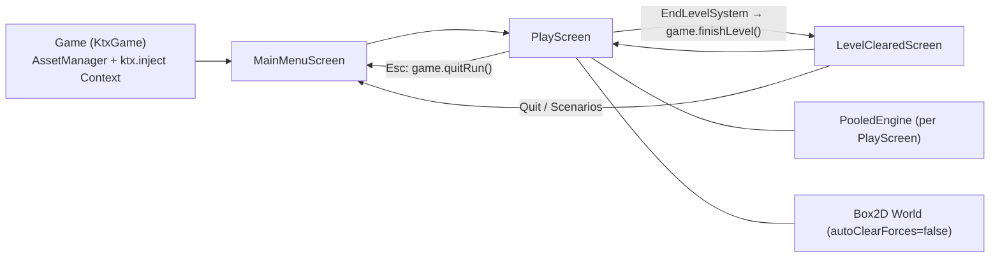

# Star Trap: Technical Architecture

Status: describes the code as of 2026-11-06 (branch `AI-slop`, after M5 gravity, black holes, planets and the pilot view). Keep this file current when the architecture changes. Agents read it before coding.

## Stack

| Area | Choice |
|---|---|
| Language | Kotlin 2.4 (JVM toolchain 25, auto-provisioned via foojay) |
| Framework | libGDX 1.14.2, KTX 1.14.2-rc2 (`app`, `ashley`, `box2d`, `inject`, `scene2d`, `math`, `log`, `graphics`, `i18n`, `preferences`) |
| ECS | Ashley 1.7.4 (`PooledEngine`) |
| Physics | Box2D (gdx-box2d), fixed step 1/`PHYSICS_TICK_RATE` s (60 Hz) |
| Build | Gradle 9.8.1, Kotlin DSL, version catalog `gradle/libs.versions.toml`, convention plugin `build-logic/src/main/kotlin/kotlin-jvm.gradle.kts` |
| Tests | JUnit 6 (Jupiter) + mockito-kotlin. Test classpath has `assets/` and desktop natives |
| Modules | `core` (all logic), `lwjgl3` (desktop launcher, construo packaging), `teavm` (experimental web), `tool` (texture packer) |

## Runtime structure

Singletons registered in `Game.create()` and fetched with `game.get<T>()`: `RandomXS128` (seeded from `LaunchOptions.seed`, or the clock), `GameState`, `OrthographicCamera`, `GameEventManager`, `SpriteBatch`, `TextureAtlas` (textures), `Skin`, `I18NBundle`, `Viewport` (`ExtendViewport`, at least 48×27 world units: a non-16:9 window or canvas sees more world, no letterbox, so the full-window HUD stage and minimap line up with it), `Stage`, `AssetManager`, `MapProvider`, `BackgroundProvider`, `KeyValueStore` (libGDX `Preferences` `star-trap-settings`; in-memory for screenshot runs), `DisplaySettings` (fullscreen, desktop only), `MenuSettings` (the player-facing settings table in `settings/MenuSettings.kt`, loaded from the store at startup), the runtime singletons `RelativitySettings` (c, engine, γ cap, field, pilot view, time warp), `ControlSettings` (`scheme`, a `ControlScheme`), `DebugSettings` (debug mode, panel, grid, vectors) and `TacticalSettings`, and the screens. `Game` takes a `LaunchOptions`, which `Lwjgl3Launcher` parses from the command line.

Input: `Gdx.input.inputProcessor` is `InputMultiplexer(Stage, GameEventManager)`. Stage goes first; `GameEventManager.keyDown` returns `true` only for keys it handles. Keys and mouse buttons come from the `input/InputBindings.DEFAULT` table (`InputAction` → `InputTrigger`), which the main-menu controls list also reads; `GameEventManager` has no key literals. New keys go in that table, never as literals (`keyAction`/`buttonAction` resolve them; the debug panel key F1 is `debugOnly`).

Player settings: `settings/MenuSettings.kt` holds one list of `SettingSpec`s (`Toggle`, `Slider`, `Choice`) that the menu, persistence and "Reset defaults" all iterate. They are saved to libGDX `Preferences` named `PREFERENCES_NAME` (`Config.kt`) through `KeyValueStore`. `Game.create()` loads them after the singletons are bound; screenshot runs (`--screenshot`) use an in-memory store, so nothing is read from or written to the prefs file. Command-line flags win over saved values (`--controls=mouse|twin|auto`, parsed by `ControlScheme.fromFlag`, is applied after loading).

Run save (`save/RunSave.kt`, ST-166): one slot in the same store under the `runsave.` prefix (a `PrefixedStore` reusing `saveSettings`/`loadSettings`), holding a format version, the next level and the `RUN_SETTING_KEYS` values; extensible with more keys. `LevelClearedScreen.show()` writes it for normal runs only; death (`Game.endRun`, non-scenario) clears it (writes version 0, since `KeyValueStore` has no remove); Esc keeps it. The main page shows "Continue (level N)" while a save exists; Continue applies the saved run physics to the runtime specs without persisting them, and New game asks to confirm, then clears the save.

Shop (`shop/`, ST-167): `DeathSystem` pays credits through the `onCredits` callback (`GameplayDeps`, no-op in the balance runner) for every asteroid (large/small) or enemy ship that reaches 0 health, whoever killed it (no player-kill attribution); `GameState.addCredits` ignores scenarios. `LevelClearedScreen` shows 3 distinct non-maxed `ShopItem`s drawn from the shared seeded `RandomXS128` (so rerolls shift the next level's RNG state); the first 2 rerolls per visit are free. Upgrades (`RunUpgrades`) are engine (a multiplier into `ShipHandlingComponent.engineFactor`, so it scales with c) and hull (start health), applied by `PlayerEntityProvider` outside scenarios. Credits and upgrade levels live in the run save (missing keys read as 0); the offer itself is not saved, so Continue goes straight to the next level.

## ECS system order

Systems are registered by `ecs/GameplaySystems.kt` `buildGameplaySystems(deps, presentation)`, called from `PlayScreen.setupEcs()` and from the headless balance runner (`tool/.../BalanceSim.kt`, ST-101), so the order cannot drift. The `presentation` callback runs after `ObserverSystem` and is where `PlayScreen` adds the GL systems (rows 11 to 16: camera, render, debug vectors, tactical overlay, debug, panel, HUD, minimap); the headless runner leaves it empty. **Registration order is execution order.**

| # | System | Responsibility |
|---|---|---|
| 0 | `TimeWarpSystem` | (ST-069) Pilot clock: fills the shared `GameClock` from the player's `RelativisticComponent.gUsed` (`warp = γ` capped at `timeWarpMax`, `worldDt = warp·realDt` capped at `MAX_LAG_STEPS` (7) steps × warp, and at `MAX_STEPS_PER_FRAME` (12) steps). `PhysicsSystem`, `LifetimeSystem` (WORLD clock) and `ObserverSystem` consume `worldDt`/`worldTime`; everything else still sees real (pilot) time |
| 1 | `EndLevelSystem` | No asteroids left → `onLevelCleared()` (`PlayScreen`: `game.finishLevel()`; the balance runner: sets a flag) |
| 2 | `PlayerInputSystem` | Input listener fills `PlayerInputState`, then delegates to the active `ControlStrategy` (selected by `ControlSettings.scheme`, a `ControlScheme`), which writes `MoveComponent.thrusters`/`targetAngleRad` and `WeaponComponent.doAttack`/`aimAngleRad`. `MouseHullStrategy` and `AutoAimStrategy` (ST-062: nearest target by TRUE body position in a 90 deg wide cone (±45°) within 40 u, aimed with `trueLeadDirection` from the true position and velocity; computer targeting since 2026-11-07, no light history) and `TwinStickStrategy` (ST-061: WASD/arrow keys give a world-frame `moveAxis` from `GameEventManager`; hull turns toward it via the PD controller, thrust = \|axis\|·max(0, cos Δ)^`TWIN_STICK_ALIGN_EXPONENT`; no axis holds the last heading; mouse aims an independent turret, RMB ignored; in pilot view (ST-131) the axis direction is screen-frame and mapped to the world with `pilotHullToWorld`, like the mouse-hull target; a scheme change zeroes `moveAxis`) exist. No lead or intercept marker is drawn on screen yet: the only lead is the auto-aim direction from `leadDirection` (constant-velocity extrapolation) |
| 2b | `EnemyAiSystem` | (ST-156) Registered right after `PlayerInputSystem`, before `MoveSystem` and `WeaponSystem`. `IteratingSystem` over `EnemyComponent` + `MoveComponent` + `WeaponComponent` + `BodyComponent`; finds the player once per update. Honest enemy pilot (E13): per enemy it asks `LightHistorySystem.historyOf(player id).retarded(enemy pos, clock.worldTime, c)`, extrapolates at constant velocity to now, steers with `pursuitCommand` (standoff `ENEMY_STANDOFF_LIGHT_SECONDS`·c, accel `engineProperAccel·engineFactor`, vMax `ENEMY_VMAX_BETA`·c) into `MoveComponent.thrusters`/`targetAngleRad`, and fires (`WeaponComponent.aimAngleRad` = `leadDirection` muzzle angle, `doAttack`) when the estimate is within `ENEMY_FIRE_RANGE_LIGHT_SECONDS`·c (2.5) and the hull (converted with `worldHullToPilot`) is within `ENEMY_FIRE_CONE_RAD` (15°) of it. No player, no history yet or no intercept: no thrust, no fire. Never reads the player's body state. No allocation per frame |
| 3 | `MoveSystem` | Step listener, `beforeStep` once per physics step. Bodies with a `RelativisticComponent`: adds `thrustAccelWorld(engineProperAccel·thr·boost, …)` to `RelativisticComponent.accel` (reverse thrust is `REVERSE_THRUST_FRACTION` as strong). Braking boost (2026-11-02): `boost = 1 + k·max(0, −cos θ)` from `brakeBoostFactor`, θ the angle between the thrust and v, k = `RelativitySettings.brakeBoost` (`BRAKE_BOOST_K` = 2), so burning straight against your motion gives 3×. Other bodies: Newtonian `applyForceToCenter` |
| 4 | `WeaponSystem` | Cooldown runs on `Entity.properDelta(clock, dt)` (ST-040), spawns projectiles via `WeaponProjectileProvider` |
| 5 | `ContactSystem` | Box2D `ContactListener`: `beginContact` calls top-level `applyProjectileHit(engine, projectile, target)`, which applies damage to `HealthComponent`, sets `ProjectileComponent.spent` and adds `RemoveComponent`. Projectiles are consumed on first hit and no longer pierce; a spent projectile ignores further hits. ST-048 ram damage: for two non-projectile, non-sensor fixtures, `ramDamage(va, vb, m0A, m0B, c)` = `(γrel − 1)·μ·DAMAGE_PER_REST_ENERGY` (0 below `RAM_GAMMA_THRESHOLD`; c cancels) is subtracted from each body's `HealthComponent`, using pre-step `vSet` velocities and `restMass`; the player's share is scaled by `PLAYER_RAM_DAMAGE_FACTOR` (0.5, ST-129, ST-101). ST-081 Doppler damage: a hit by a photon (`PhotonComponent`) with `RelativitySettings.photonDopplerDamage` (and relativity on) multiplies `LaserProjectile.damage` by `photonEnergyFactor` = `γt(1 − βt·n̂)/(γs(1 − βs·n̂))` (research E12) clamped to `PHOTON_DAMAGE_D_MIN..PHOTON_DAMAGE_D_MAX` (0.25..4), with βs stored in `ProjectileComponent.shooterBetaX/Y` at emission and βt from the target's pre-step `vSet / c`; `ProjectileSweepSystem` passes the same settings to `applyProjectileHit`. Asteroid health scales with rest mass (`asteroidHealth`, large = `ASTEROID_LARGE_HEALTH`). Split fragments spawn with `AsteroidComponent.ramImmunity = FRAGMENT_RAM_IMMUNITY` (a few physics steps) and a contact with an immune body does no ram damage, so the ship that broke the parent isn't hit twice; `ContactSystem` is also the last `PhysicsStepListener` and counts the immunity down in `afterStep`. Allocation-free (scratch vectors) |
| 6 | `BoundaryFieldSystem` | Physics step listener, passed to `PhysicsSystem`. `beforeStep`: mass-independent repulsive boundary field (`physics/BoundaryField.kt`) as force on dynamic bodies, projectiles are ignored: they leave the arena, leaving one ripple where they cross the wall. `afterStep`: hard backstop (clamp inside, reflect outward velocity), emits shimmer impacts into `ShimmerImpacts` and advances its clock. Lazily fills `BodyComponent.boundingRadius` |
| 6b | `GravitySystem` | (ST-083) Step listener registered right after `BoundaryFieldSystem` (order: thrust, field, gravity, sweep, relativistic, light history). `beforeStep`, skipped with `RelativitySettings.gravityEnabled` off or no `GravitySourceComponent` entities (all levels until ST-085): sources (dynamic bodies, Newtonian path) get Box2D forces from the other sources (`sourceCoupling` times `newtonAccel`, softening `max(radius_i + radius_j, SOURCE_PULL_MIN_SOFTENING)`) and from the player (`playerGm`, `PLAYER_PULL_SOFTENING`); relativistic bodies get `gravityAccelTau / gUsed` (black holes) or `newtonAccel / gUsed` (planets) added to `RelativisticComponent.accel`; other dynamic bodies get a force, non-photon kinematic projectiles a velocity kick; photons are bent by `bendPhoton` per source and reset to `c·dir` (substepped `PHOTON_SUBSTEPS`× within `PHOTON_SUBSTEP_RADIUS_PER_RS · r_s` of a hole), their body angle follows `dir`. Asteroids, debris and photons never pull. No allocation per step. `afterStep` (ST-085, runs even with gravity off): **merge**: two holes closer than `rs₁ + rs₂` merge via `mergeSources` (rs as mass), the lower id survives at the centre of mass with the merged velocity and a new sensor fixture of radius `rs₁ + rs₂`, the other gets `RemoveComponent` and is skipped as a source for the rest of the frame; **horizon**: a non-source body within `rs` of a hole gets `RemoveComponent` (no death path, so asteroids don't fragment), the player instead gets `health = 0` |
| 7 | `ProjectileSweepSystem` | Registered before `PhysicsSystem` and passed as its third step listener (order: thrust, field, sweep). `afterStep`: for each unspent projectile, `world.rayCast` from `TransformComponent.prevPosition` (start-of-tick position) to the current body position, so fast sensor projectiles can't tunnel through small targets. Ignores own body, sensors and non-colliding factions (`collidesWith`), keeps the nearest hit and calls `applyProjectileHit`. Photons (the default weapon, ST-034) are fired at `settings.c` and live `PHOTON_WORLD_LIFETIME` (2 s) of world time. Valid while `PHYSICS_SUBSTEPS = 1`. Known limitation: a projectile reflected by the boundary backstop gets a chord ray from its old position to the post-reflection position (low risk) |
| 8 | `RelativisticDynamics` | Registered right before `PhysicsSystem` and passed as a step listener, after `GravitySystem` and `ProjectileSweepSystem` and before `LightHistorySystem` and `ContactSystem` (full order in the physics loop section). `beforeStep`: resets non-finite `u`/`accel` to zero, `u += accel·dt`, `clampU` to `gammaMax`, writes `v = u/γ` into the body, remembers `vSet` and `gUsed`. `afterStep`: if the body velocity differs from `vSet` by more than `COLLISION_EPS` (contact, backstop), clamps it to `BETA_MAX_MASSIVE·c` and sets `u = uFromV(v)`; then `tau += dt/gUsed` and clears `accel`. Family `RelativisticComponent` + `BodyComponent` |
| 8b | `LightHistorySystem` | Registered after `RelativisticDynamics`, passed as a step listener, before `ContactSystem` (order: thrust, field, gravity, sweep, relativistic, light history, contact), and an `EntityListener`. `afterStep`: `time += dt` (= `GameClock.worldTime`), records `(time, x, y, angle, vx, vy)` of every `BodyComponent`+`BaseInfoComponent`+`TransformComponent` entity into a `LightHistory` keyed by `BaseInfoComponent.id`; first seen within one step means `eternal`. `entityRemoved` keeps the history and stores `removedAt`; pruned after `LIGHT_HISTORY_CAPACITY` steps, objects reused via a free list. API: `historyOf(id)`, `removedAt(id)` (NaN while alive), `now`, `clear()` (called in `PlayScreen.show`) |
| 9 | `PhysicsSystem` | Accumulator stepping on `GameClock.worldDt` (max `MAX_STEPS_PER_FRAME` = 12 steps/frame, `TIME_WARP_MAX_LIMIT` (12) at `REFERENCE_FPS` 60; step test uses a 1e-6 epsilon). Per step: listeners' `beforeStep`, `ShipRotationController` angular impulse for entities with `targetAngleRad`, `world.step`, listeners' `afterStep`, `clearForces`. Transform interpolation runs once per frame |
| 10 | `ObserverSystem` | Fills `physics/ObserverState` from the player once per frame: position, `betaRaw = v/c` (v from `velocityFromU(u)`), `gammaRaw`, `rapidity`, `tau` (from `RelativisticComponent`, else world time), `worldTime`, plus `betaVisual`/`gammaVisual` low-pass filtered with `VISUAL_BETA_SMOOTHING` (`smoothToward`). Owned by `PlayScreen`, reset in `show()` |
| 11 | `CameraSystem` | Follows player (clamped to map plus `settings.fieldParams.skin / 2` margin), mouse wheel zoom 0.5–2 |
| 12 | `RenderSystem` | Nebula background + `Starfield` (camera-relative parallax; with a black hole it goes through `render/LensingPass`: into an off-screen buffer, then to the screen with a lens quad per hole, ST-088), then the reference grid (`render/ReferenceGridRenderer`, ShapeRenderer lines every 20 u, brighter centre axes; toggle `DebugSettings.gridEnabled`), then sprites (interpolated transforms; with `RelativitySettings.pilotView`, default off (`PILOT_VIEW_DEFAULT`, Outside is the default and Pilot is a menu option), V toggles, `render/PilotViewProjector` draws every non-player sprite at its retarded position from `LightHistorySystem` boosted into the pilot frame by `betaVisual`, skips entities whose light has not arrived, and draws the player unboosted at the camera centre; the camera is then unclamped. Physics, minimap and HUD stay in arena coordinates; the grid and boundary band are still drawn in arena coordinates), then the boundary field band via `render/FieldShimmerRenderer` (`assets/shaders/field_shimmer.*`: honeycomb brightening with depth plus ripples expanding at c from `ShimmerImpacts`, additive blend; `u_time` is `ShimmerImpacts.time`; falls back to a pulsing tint if the shader fails to compile). `RenderSystem` is `Disposable` and disposes the renderer |
| 12a | `HullSoundSystem` | (ST-135) Presentation, right after `RenderSystem`: engine loop volume/pitch from the player's `MoveComponent.thrusters` (smoothed, one loop instance), one-shots (`laser_fire`, `hull_hit`, `hull_scrape`) from `audio/HullSoundQueue`, filled by `WeaponSystem` and `ContactSystem`. Hull-only sounds, no Doppler. Needs `SoundBank`, so not in the headless runner. See `docs/tech/sound.md` |
| 12b | `DebugVectorSystem` | (ST-060) When `DebugSettings.showVectors`: ShapeRenderer arrows from the interpolated position for `v` (green), `u` (cyan) and `RelativisticComponent.lastAccel` (orange), plus a grey c ring around the player. Scales are c-relative (`vectorScales`). `Disposable` |
| 12c | `TacticalOverlaySystem` | (ST-123) Tactical computer: over the sprites, thin ShapeRenderer outlines of every body at its true interpolated arena position (`render/TacticalOverlay.kt` `outlineVertices`, min radius 4 px), arena-frame velocity arrows (`arrowSegments`, `tacticalArrowScale(c)`, none for projectiles) and the arena border. ST-133: a `×1.8`-style label (green ≥ 1, red < 1) next to the aimed target (auto-aim target, else the health body nearest the cursor) shows `displayedPhotonFactor` (clamped `photonEnergyFactor`, true-state β); needs `showLaserDamage`, relativity and `photonDopplerDamage`. ST-125 (tier ≥ `TACTICAL_TIER_INTERCEPT`, the default): for the nearest `TACTICAL_LEAD_MAX` health targets within `tacticalLeadRange(c)` (2 s of light), a ring + line at the true-state photon intercept point (`trueLeadDirection` from the muzzle world position, ST-137; toggle `TacticalSettings.showInterceptMarkers`; muzzle direction n̂′ for turret schemes or pilot view, else mapped to the W hull angle for outside-view mouse-hull). Target rings (2026-11-07, toggle `TacticalSettings.showTargetRings`, default on, drawn even when the overlay is hidden): a glowing red circle around every level target at its TRUE interpolated position (also in pilot view, where it can sit apart from the delayed sprite), radius `targetRingRadius` (bounding radius + 6 px, min 10 px), glow = concentric 1.5 px rings with `TARGET_RING_LAYER_ALPHA` drawn additively, outer layers pulse (`targetRingLayerAlpha`). Circles pass explicit segment counts (`TARGET_RING_SEGMENTS`, `TACTICAL_LEAD_RING_SEGMENTS`): ShapeRenderer's default is too coarse at small world radii. The rest is drawn only when `tacticalOverlayVisible(TacticalSettings.mode, pilotView, player's TacticalComputerComponent.tier, inverted)`. `Disposable` |
| 13 | `DebugSystem` | (draws only when `DebugSettings.debugMode`) Box2D debug renderer |
| 14 | `DebugPanelSystem` | (ST-059) Refreshes the `ui/DebugPanel` readouts at 10 Hz via `panel.update(observerState, playerRel)`; runs only while the panel is visible. Placed just before `HudSystem` because `HudSystem` acts and draws the stage |
| 15 | `HudSystem` | scene2d HUD; also acts and draws the whole `Stage`, including the debug panel. Also draws edge arrows (`render/EdgePointer`, selection in `render/TargetPointers`) to **every** off-screen level target (`ecs/LevelTargets.kt` `levelTargetFamily()`: asteroids and enemy ships without `RemoveComponent`, the set `EndLevelSystem` waits for; debris, planets and holes get none), red for enemies, grey for asteroids, alpha fades 0.9 to 0.3 over 120 u, with a distance label on the nearest (toggle `DebugSettings.targetPointersEnabled`). Arrows and distance are a computer assist: they use the **true** interpolated position, also in pilot view (owner 2026-11-07), like the target rings, lock reticle and auto-aim. Each frame it counts level targets by kind (`ui/TargetCounts.kt` `countLevelTargets`) for the top-right "Targets left" HUD block (`Hud.updateTargets`, rebuilt only on change; the enemy row shows once the level has had enemies) |
| 16 | `MinimapSystem` | Bottom-right minimap (`ui/MinimapViewport`): arena background, entity dots, camera view rectangle, arena border |
| 17 | `LifetimeSystem` | `LifetimeComponent.remaining -= dt`; at 0 adds `RemoveComponent`; fades sprite alpha over the last `LIFETIME_FADE_SECONDS`. WORLD clock uses `GameClock.worldDt`; PROPER clock uses `Entity.properDelta` (ST-040: player real time, other relativistic bodies `worldDt/gUsed`) |
| 18 | `DeathSystem` | health ≤ 0 → asteroid split, add `RemoveComponent` |
| 19 | `RemoveSystem` | Out-of-bounds safety net: bodies beyond the map plus a 20 % margin get `RemoveComponent`, except the player, which is clamped to 1 unit inside the map with velocity zeroed. Destroys bodies, removes entities |

## Debug panel (ST-059)

`ui/DebugPanel` is a scene2d `Table` docked on the right of the `Stage` (260 px, translucent black background from the skin's `white` region). It exists only when `DebugSettings.panelAllowed` (the "Debug mode" setting or `--debug-panel`, which also shows it at launch); `PlayScreen.show` adds it and registers it as a `DebugInputListener` (F1 toggles `panelVisible`, and the cursor swaps between Arrow and Crosshair). Contents: readouts (β, γ, τ, world t, |v|, |u|, ship-frame speed, c, a0; text built by the pure `formatReadouts`), toggles (relativity, boundary field, show vectors), time scale buttons, sliders (c, a0, field damping, γ cap) writing `RelativitySettings`, a control scheme `SelectBox` and "reset defaults". Labels are English literals (developer tooling, no i18n).

## Components (`core/.../component/`)

`BaseInfoComponent` (id, faction, `EntityType`; every entity has one), `BodyComponent` (Box2D body, `boundingRadius` for the boundary field, -1 until computed), `TransformComponent` (prev + interpolated position/rotation), `SpriteComponent`, `MoveComponent` (thrusters −1..1, `targetAngleRad` world angle or null), `WeaponComponent`, `ProjectileComponent` (sealed projectile types, currently `LaserProjectile`; `spent` flag), `GravitySourceComponent` (ST-083: `kind` BLACK_HOLE or PLANET, `rs`, `gm`, `softening`, `radius`, `effectiveGm(c)`; sits on a dynamic body without `RelativisticComponent`), `PhotonComponent` (ST-039: unit flight direction `dir` of a photon laser after muzzle aberration), `HealthComponent`, `AsteroidComponent`, `PlayerComponent` (mapper and `playerCmpOptional`), `ShipHandlingComponent` (per-ship PD gains, defaults from `ShipRotationController`; `engineFactor` scales the engine's proper acceleration, enemies use `ENEMY_ENGINE_FRACTION`), `EnemyComponent` (ST-155: marker for enemy ships, which must be destroyed to clear the level), `WeaponLoadoutComponent` (ST-163: three weapon slots, selected with keys 1/2/3, each with its own cooldown), `LifetimeComponent` (remaining/total, `LifetimeClock` WORLD or PROPER), `RemoveComponent`, `TacticalComputerComponent` (ST-123: `tier`, gates the tactical overlay; player only), `RelativisticComponent` (ST-037: proper velocity `u`, per-step `accel` accumulator, proper time `tau`, `gUsed`, `vSet`, `gammaMax`; added to the player and all asteroids when `RELATIVITY_ENABLED`).

The convention is described in `CLAUDE.md`: a `Poolable` class, `xxxMapper`, and `Entity.xxxCmp`/`xxxCmpOptional`.

## Physics loop details

- `PHYSICS_UPDATE_INTERVAL = 1/PHYSICS_TICK_RATE` (60 Hz), velocity iterations 6, position iterations 2. `PHYSICS_TICK_RATE` is the one base constant: `C_MAX_BOX2D_SAFE`, `MAX_STEPS_PER_FRAME` (12) and `MAX_LAG_STEPS` (7) derive from it. `TimeWarpSystem` caps the world time per frame at `MAX_LAG_STEPS` intervals at warp 1 and `MAX_STEPS_PER_FRAME` at high warp. The pilot clock is `physics/GameClock` (`realDt`, `warp`, `worldDt`, `worldTime`, `warpCapped`, `stepsCapped`); `warp` is the player's γ capped at `timeWarpMax` (`TIME_WARP_MAX` 10). Above the cap the world runs slower than the pilot's γ demands (declared FAKE).
- Once per frame, `preProcess` stores each body's previous position and rotation. After the stepping loop, `interpolateTransforms` lerps `TransformComponent.interpolatedPosition/RotationDeg` with `alpha = accumulator / interval`. Rendering uses only these interpolated values.
- `autoClearForces = false`. `PhysicsSystem` takes a list of `PhysicsStepListener`s (`MoveSystem`, `BoundaryFieldSystem`, `GravitySystem`, `ProjectileSweepSystem`, `RelativisticDynamics`, `LightHistorySystem`, `ContactSystem`, in that order). For every step it runs `beforeStep(dt)` on each listener, then `applyRotation()`, `world.step`, `afterStep(dt)` on each, then `world.clearForces()`. Thrust is applied in `beforeStep`, so it acts once per step. `PHYSICS_SUBSTEPS = 1` splits each step into sub-steps if needed.
- **RelativitySettings (ST-056):** `physics/RelativitySettings` is a mutable singleton in DI (`Game.create` binds it, `PlayScreen` passes it to `MoveSystem`, `RelativisticDynamics`, `BoundaryFieldSystem`, the providers and `FieldShimmerRenderer`). Runtime code reads `c`, `engineProperAccel`, `gammaMaxMassive`, `fieldParams`/`fieldDamping` and the switches `relativityEnabled` / `fieldEnabled` from it; the consts in `PhysicsConstants.kt` are only defaults. Setters clamp (`c` to `[C_MIN, C_MAX_BOX2D_SAFE]`). Providers always attach `RelativisticComponent`; with `relativityEnabled = false` `MoveSystem` uses Newtonian force and `RelativisticDynamics` keeps `u` synced from the body velocity. With `fieldEnabled = false` only the hard backstop acts. Changing `c` mid-flight keeps `u`; photons in flight keep their speed until they bounce.
- **Black holes (ST-085):** `BlackHoleProvider.spawn(level, random)` places 1 hole (2 from level 3) when `RelativitySettings.blackHolesEnabled` (debug checkbox, applies next level), before asteroids. Body: dynamic, fixed rotation, at rest, one sensor circle of radius `rs` with `maskBits = 0` (no contacts); it moves under source–source gravity and the boundary field. Placement rule is the pure `validSourcePosition` (≥ `BH_WALL_MARGIN` 30 u from walls, ≥ `BH_CENTER_CLEARANCE` 40 u from the player spawn, ≥ `BH_MIN_SEPARATION` 60 u apart; shared with planets/ST-093/094). `AsteroidProvider` resamples spawn points within `BH_ASTEROID_CLEARANCE = 8·BH_RS` (up to 50 tries, then skips that asteroid). `render/BlackHoleRenderer` draws shadow (2.598·rs), photon ring (1.5·rs) and dashed ISCO (3·rs) after the backdrop; in pilot view each ring is boosted point by point (`PilotView.retardedCentre` + `apparentPoint`). **Accretion disk (ST-087):** `render/AccretionDisk.kt` holds the pure `diskTemperature`/`diskRedshift`/`diskOmega`/`buildDiskVertices` and `AccretionDiskShader` (program `accretion_disk.vert/.frag`, 256×1 blackbody LUT texture from `BlackbodyLut`). One static `Mesh` of `DISK_PARTICLES` quads per hole (cached in `BlackHoleRenderer` per entity, rebuilt with the same seed when `rs` changes); the GPU turns each particle by `phi = phi0 + sqrt(gm/r³)·worldTime` (`ObserverState.worldTime`, highp vertex shader, additive blending, LUT sampled in the fragment shader). In pilot view (ST-089) `BlackHoleRenderer` passes the hole's retarded centre, light age and velocity (`PilotViewProjector.retardedCentre`, `centreLag`, `centreVx/Vy`) to `AccretionDiskShader.drawPilot`; the vertex shader mirrors the pure `diskParticleApparent`: per-particle light delay on the orbit, the aberration boost and a Doppler factor that scales the colour temperature and the brightness (`spriteBrightness`), so the side swinging toward the pilot is bluer and brighter (physics-lies row 26). `EndLevelSystem` counts asteroids and enemy ships (`oneOf(AsteroidComponent, EnemyComponent)`, ST-155).
- **Planets (ST-093):** `PlanetProvider` (takes `RelativitySettings` and a `createSprite` lambda so tests run without GL) spawns `planetCount(level)` planets (1, 2 from level 4) after holes and before asteroids when `planetsEnabled`. Solid dynamic circle (`PLANET_RADIUS`, `PLANET_DENSITY`, NEUTRAL filter), no health, no `RelativisticComponent`; `GravitySourceComponent(PLANET)` with `gm = planetGm(settings)` computed at spawn (surface gravity = half the engine's proper acceleration). Placement via `validSourcePosition` (wall margin 25, 30 u from centre/other sources). `GravitySystem.eatPlanets()` (afterStep, after the horizon pass) removes a planet within `rs + 0.5·radius` of a live hole. `AsteroidProvider.nearSource` uses per-kind clearance. Sprites come from `render/PlanetTextures` (DI Disposable, 4 procedural 96×96 variants from the pure `planetTexel`, nearest filtering). Minimap: grey disc at true scale.
- **Debris (ST-094):** `DecorationProvider` spawns `debrisCount(level)` (6) small NEUTRAL `DEBRIS` pieces after asteroids when `decorationEnabled` (atlas region `debris`, `HealthComponent(10)`, dynamic circle, at rest; placement: wall margin 15, ≥ 20 u from centre, ≥ 12 u from sources, ≥ 8 u apart). No `AsteroidComponent` (not counted by `EndLevelSystem`, not split by `DeathSystem`) and no `RelativisticComponent`. Minimap: dim grey dot; auto-aim only locks asteroids (ST-142), so debris is never targeted; `TacticalOverlaySystem` draws a lock-on reticle on the locked target. Spawn order in `PlayScreen.show`: holes, planets, asteroids, debris, then (after `star.roll`) enemies. **Enemy ships (ST-155):** `EnemyShipProvider.spawn(level, random, mapProvider, avoid)` places `enemyCount(level) = min(ENEMY_MAX = 3, max(0, level - ENEMY_FIRST_LEVEL + 1))` ships (`ENEMY_FIRST_LEVEL = 3`, owner decision ST-160: none on levels 1-2, then 1, 2, 3) when `RelativitySettings.enemiesEnabled` (debug checkbox, next level): `EnemyComponent` marker, FACTION `ENEMY`, `EntityType.SHIP`, box hull (`spaceship/attecker_red`, density = player's), `RelativisticComponent`, `ShipHandlingComponent.engineFactor = ENEMY_ENGINE_FRACTION` (`MoveSystem` scales `engineProperAccel` by it), laser `WeaponComponent` (10 dmg, 1 shot/s), `HealthComponent(100)`. Spawn points: seeded random, >= 3 light-seconds from the player, valid per `validSourcePosition` against holes and planets. `EnemyAiSystem` (ST-156) drives them; auto-aim locks `ASTEROID` and enemy `SHIP`; the generic `DeathSystem` path removes dead ones via `RemoveComponent`.
- **Gravitational time dilation (ST-086):** `GravitySystem.beforeStep` sets `RelativisticComponent.gravFactor = ∏ gravTimeFactor(r, effectiveRs(c))` over live sources for every relativistic body (1 with gravity or relativity off, or no sources; planets use `rsFromGm`). `RelativisticDynamics.afterStep`: `tau += dt·gravFactor/gUsed`. Non-player `properDelta` and `rotationTimeFactor` use `gravFactor/gUsed`. `TimeWarpSystem` warps by `effectiveGamma = gUsed/gravFactor` (reads the previous step's value), still capped by `timeWarpMax`.
- **Relativistic mass in collisions (ST-047):** with `RelativitySettings.gammaMassEnabled` (default `GAMMA_MASS_ENABLED`) and relativity on, `RelativisticDynamics.beforeStep` sets the Box2D mass and inertia to `min(γ, GAMMA_MASS_CAP = 8)·` the rest values (`RelativisticComponent.restMass/restInertia`, captured by the providers; `massGamma` is the γ currently applied, updated only when it changes by more than 1 %, via one reused `MassData`). Box2D contacts then conserve `Σ γ m v`, and the `afterStep` readback is `u = gUsed·v` (clamped) instead of `uFromV`. Relativity off restores the rest mass. Thrust and the field are accelerations and the PD rotation controller applies `inertia·Δω`, so none of them depend on the mass; the debug panel mass readout shows the current Box2D mass. Lie row 8 in `physics-lies.md`.
- **Relativistic integration (ST-037):** contributors add proper accelerations into `RelativisticComponent.accel` during `beforeStep`, and `RelativisticDynamics` (last) integrates `u` and writes `v = u/γ` into Box2D, so Box2D only does collisions. `afterStep` reads back any contact-changed velocity into `u`. The boundary field (ST-038) adds its acceleration to `accel` with damping on `u`, and its backstop reflects `u` and sets `vSet`, so relativistic bodies get no direct Box2D forces. Forces applied directly to a relativistic body would change its velocity during the step; `afterStep` picks that up only when the change exceeds `COLLISION_EPS` (0.05 u/s per step, i.e. accelerations above `COLLISION_EPS × tick rate`, about 3 u/s² at 60 Hz), smaller pushes are lost. The angular impulse stays Newtonian, but `PhysicsSystem.applyRotation` scales the PD gains by the clock factor `f` (`Entity.rotationTimeFactor`: `1/warp` for the player, `1/gUsed` for other relativistic bodies), and `RelativisticDynamics.beforeStep` rescales free spin (no `targetAngleRad`) by `gUsedPrev/g` (ST-040).
- **Rotation (ST-004):** `PlayerInputSystem` writes the world angle to `MoveComponent.targetAngleRad`. `ShipRotationController` is a PD controller (kp 80, kd 2√kp, acceleration clamp ±200 rad/s², angular velocity cap 2π rad/s). `PhysicsSystem` turns its output into an angular impulse before **every** `world.step`, so it stays correct with several substeps per frame. Entities with a null `targetAngleRad` are not rotated. Angle error uses `shortestAngleDiffRad`, so the ship always turns the short way.
- **Box2D speed cap:** `b2_maxTranslation = 2.0` units per step, so the hard cap is `2 × tick rate` (120 u/s at 60 Hz) and the safe limit `C_MAX_BOX2D_SAFE = 0.75 × 2 × tick rate` is **90 u/s**. `SPEED_OF_LIGHT = 20` (in `physics/PhysicsConstants.kt`) sits well under it. `ENGINE_PROPER_ACCEL` derives from c (`c·γβ(0.9)/5 s`, about 8.26), and `ASTEROID_SPAWN_BETA_MAX` is a fraction of c.
- Units: 1 world unit = 18 px (`UNIT_SCALE`). The map is 200×200 units (field skin 10 u). The view is 48×27 units at zoom 1.
- **Boundary field (`BoundaryFieldSystem`):** the field acts on bodies before each step, and the hard backstop runs after it. Constants are in `physics/BoundaryField.kt`.

## Pilot view, gravity settings, death and lighting (M4 and M5)

- **Pilot view render path (ST-074, ST-131).** `RelativitySettings.pilotView` is the switch: default `PILOT_VIEW_DEFAULT` = false (Outside), V toggles it in game (`InputAction.TOGGLE_PILOT_VIEW`), and the main menu sets it. With it on, `RenderSystem` draws every non-player sprite through `render/PilotViewProjector` at its retarded position from `LightHistorySystem`, boosted into the pilot frame by `betaVisual` (`physics/PilotFrame.kt`). It skips entities whose light has not arrived and draws the player unboosted at the camera centre. Two debug switches split the view: `pilotAberration` (the boost) and `pilotDelay` (the retarded positions). `pilotHullTransform` = `pilotView && relativityEnabled && pilotAberration` is the single gate for the hull angle and the cursor mapping. Physics, minimap and HUD always use arena coordinates. Deliberate approximations of this path are listed in `docs/design/physics-lies.md`.
- **Gravity settings (ST-083 to ST-086).** `RelativitySettings` holds `gravityEnabled` (`GRAVITY_ENABLED` = true), `sourceCoupling` (source-to-source pull, default `SOURCE_COUPLING_DEFAULT` = 0.1, FAKE, ST-092), and `playerGm` (the player as a source, default `PLAYER_GM` = 30, clamped to `PLAYER_GM_MAX` = 200, softening `PLAYER_PULL_SOFTENING` = 2). Photon bending in `GravitySystem` is split into `PHOTON_SUBSTEPS` (10) substeps within `PHOTON_SUBSTEP_RADIUS_PER_RS` (6) × `r_s` of a hole. Level content toggles: `blackHolesEnabled`, `planetsEnabled`, `decorationEnabled` (all true by default; they apply from the next level).
- **Tidal stretching (ST-153, physics-lies row 19e).** `GravitySystem.afterStep` ends with `applyTidal` (runs even without sources, to reset): for every non-source body with a `RelativisticComponent` and `boundingRadius > 0` (filled lazily like `BoundaryFieldSystem` does) it takes the largest `tidalAccel(r, gm, 2·boundingRadius)` over live sources and stores `tidalRatio = Δa / (engineProperAccel · TIDAL_TOLERANCE_ENGINES)` and the unit direction `tidalDirX/Y` (source to body) in `RelativisticComponent`. `tidalRatio > 1` with a `HealthComponent` costs `TIDAL_DPS · (ratio − 1) · dt · gravFactor/gUsed` health (only while health > 0). Gate: `RelativitySettings.tidalEnabled` (debug "tidal"), independent of `gravityEnabled`. The ratio is 0 with tidal off. Render: `RenderSystem` (world view) and `PilotViewProjector.project` (pilot view) apply `tidalOffset` with `s = tidalStretch(ratio)` (`min(1.5, 1 + 0.25·ratio)`, skipped below `TIDAL_VISUAL_MIN_SCALE` 1.01) to the 4 corner offsets about the sprite centre before the length contraction; both read the true current `tidalRatio`, not a retarded one. HUD readout (ST-162): `HudSystem` feeds the player's `tidalRatio` to `Hud.updateTidal`, which shows "Tidal stress: N %" above `TIDAL_READOUT_MIN` (0.25), red above 1 (`tidalReadoutPercent`/`tidalReadoutDamaging`); the text is rebuilt only when the percent changes. The optional threshold ring was skipped.
- **Black holes and planets (ST-085, ST-093).** Both are `GravitySourceComponent` sources (`GravitySourceKind.BLACK_HOLE` / `PLANET`); their `BaseInfoComponent.entityType` is `EntityType.BLACK_HOLE` / `PLANET`. A hole's body is one sensor circle of radius `r_s` with no contact mask; horizon capture and merging are done by `GravitySystem.afterStep`, not by contacts. A horizon hit removes a non-source body with `RemoveComponent` (no split), and it sets the player's `health = 0`. `GravitySystem.eatPlanets()` removes a planet inside a hole's horizon band. Planets are solid and indestructible. Debris (ST-094) is not a source and does not pull.
- **Runs and scenarios.** New game calls `GameState.resetGame(startLevel)` (1 or 5) and saves the run's physics choices (`RUN_SETTING_KEYS`). A scenario (`scenario/Scenarios.kt`) calls `applyScenarioPhysics` and `GameState.startScenario`; `PlayScreen.show()` then loads a map of the scenario's `arenaSize` and runs its spawn script through `ProviderSpawner` instead of the procedural level, and shows a `BriefingPanel`. The main menu reloads the saved physics settings on every show, so scenario overrides never stick. Esc (`QUIT_TO_MENU`) calls `Game.quitRun()`.
- **Player death flow.** `DeathSystem` (row 18) sees the player's `HealthComponent` ≤ 0 (from damage or the horizon), calls `onPlayerDeath` once (`PlayScreen` → `Game.endRun()`), and does not remove the player. `endRun()` ignores player input, posts a runnable that resets `GameState` and sets `lastRunEnded`, and switches to `MainMenuScreen`. The level is cleaned up by the screen switch. Asteroids and other bodies keep the normal death path.
- **Lit sprites (ST-095, ST-096, ST-097).** `render/Lighting.kt` is the pure CPU reference (`LightSource`, falloff, wrapped diffuse, `pickLights`, `shade`; `MAX_LIGHTS_PER_SPRITE` = 4, `LIGHT_HEIGHT` = 2 u, `LIGHT_AMBIENT` = 0.35, `DISK_LIGHT_*`). `render/LightSources.kt` rebuilds one disk light per black hole every frame (size and range scale with `rs/BH_RS`); `RenderSystem` draws lit entities through `LitSpriteRenderer` and `assets/shaders/lit_sprite.{vert,frag}` (the GLSL mirrors `shadeSpriteTexel`): per lit sprite it picks the 4 strongest lights, sets uniforms, draws and flushes (one draw call per lit sprite; budget about 150). Lit: ships, asteroids and debris whose atlas region has a `<name>_n` normal map from the packer (matched by page texture and pixel origin at construction, because `createSprite` returns plain `Sprite`s that have lost their region name), and planets with an analytic sphere normal. Asteroids and debris blend their map normal with a sphere normal (`ASTEROID_DOME_BLEND` = 0.7, ST-148, physics-lies row 43), because the packer's normal map is only a thin bevel round a flat +z interior and the low disk light (`LIGHT_HEIGHT`) would otherwise only light the rim. Lasers, thrusters and explosions keep the default shader. The shader works in the arena frame from the sprite's interpolated (world view) or retarded (pilot view) position and angle; the vertex colour (Doppler tint, searchlight) multiplies on top. Ambient is `LIGHT_AMBIENT_NO_STAR` = 1 until a directional light (star) exists, then `LIGHT_AMBIENT` = 0.35 (`LightSources.ambient`, physics-lies row 42). Toggle: `RelativitySettings.lightingEnabled` (debug panel "lighting"); with it off, or no light, the output is unchanged. Pilot-view FAKEs: `physics-lies.md` rows 39-41. Shadows (ST-098, `RelativitySettings.shadowsEnabled`, debug "shadows"): planets and asteroids with `boundingRadius ≥ OCCLUDER_MIN_RADIUS` (1.5 u; large asteroids 2.25, planets 2.5; small asteroids, ships and debris don't cast) are collected per frame in `OccluderPool` (`RenderSystem`, `rebuild` in `LightSources.kt`). Per lit sprite `selectOccluders` keeps up to `MAX_OCCLUDERS` (6) circles that come within `cr + spriteRadius` of the segment to one of the picked lights (never the sprite's own circle), moved back by the sprite's pilot-view lag along their velocity; the shader (`u_occ[]`, `u_occCount`) multiplies each light's term by the product of `circleShadowFactor` (a smoothstep penumbra, `w = size·t/|l−p|` for the disk, `STAR_ANGULAR_SIZE·t` for the star, at least `MIN_PENUMBRA`). The disk is large (`DISK_LIGHT_SIZE` 12 u), so its shadows are mostly penumbra: a body behind a planet gets roughly 15-30 % of the disk light, not 0. Ambient is never shadowed. Physics-lies row 44. Harness: `--shadow-demo`. Star (ST-099, `render/StarLight.kt`, `RelativitySettings.starLightEnabled`, debug "star light"): `PlayScreen.show()` rolls angle (0..2π) and temperature (4000..9000 K) from the seeded random after all spawn draws, so layouts don't shift; `LightSources.rebuild` puts it first as a directional light (`STAR_LIGHT_INTENSITY` 1.25, `STAR_ELEVATION` 40 degrees, colour from `BlackbodyLut`), which switches ambient to 0.35 for the level; `MinimapSystem` draws a faint arrow at the map edge toward it. No star sprite. Not used by the headless balance runner. 
- **Backdrop lensing (ST-088, `render/LensingPass.kt`, `assets/shaders/lensing.{vert,frag}`, `RelativitySettings.lensingEnabled`, debug "lensing", harness `--no-lensing`).** `RenderSystem.drawBackdrop` runs first in the render pass. With at least one black hole (planets don't lens) and lensing on, the nebula and starfield are drawn into a back-buffer sized `FrameBuffer` (RGBA8888, no depth, linear filter, clamp-to-edge; recreated when `Gdx.graphics.backBufferWidth/Height` change, disposed with the system, falls back to the direct draw if creation fails or the shader does not compile). `LensingPass.draw` blits it to the screen with `batch` and an identity projection (opaque), then draws one quad per hole (a static 4-vertex strip scaled in the vertex shader, no per-frame allocation) of half-size `LENS_QUAD_HALF` (3) `R_E`, `R_E = LENS_EINSTEIN_RADIUS_RS` (4) `r_s`. `lensing.frag` mirrors the pure `lensSourceOffset` (thin lens `src = rho (1 - w R_E^2/|rho|^2)`, black inside the shadow, `w` fades the deflection to 0 over the outer 30 % of the quad so there is no seam) and samples the buffer at the lensed point through a per-hole texture-coordinate origin and two axis vectors from `camera.combined` (so it works for any orthographic camera, and the fragment needs no matrix). Order is now backdrop (lensed) -> grid -> `BlackHoleRenderer` (shadow, rings, disk) -> sprites. In pilot view the lens sits at the hole's apparent position (physics-lies row 19). Only the backdrop is lensed; sprites, the grid and the disk are not. `lensing.frag` also multiplies the colour by `lensGain` (point-source magnification, capped at `LENS_GAIN_MAX` 4; ST-150). The black hole shadow, photon ring and dashed ISCO (black holes only, `drawsHoleRings`; planets get none) are ShapeRenderer rings in `render/BlackHoleRenderer` (boosted per point in pilot view). The Einstein ring assist (ST-151, `DebugSettings.einsteinRingEnabled`, menu "Einstein ring", default on) draws a dashed cyan ring at `einsteinRingRadius(rs) = LENS_EINSTEIN_RADIUS_RS * rs` after the disk so the particles do not hide it.

## Collision filtering

`FactionEnum` (`PLAYER`, `NEUTRAL`, `ENEMY`). `ownCategoryBit` is the faction's own bit and is set as the fixture's `categoryBits`. `collidesWithMask` holds the bits the faction collides with and is set as `maskBits`. `FactionEnum.collidesWith(other)` checks the symmetric rule.

## Known issues and tech debt

These are input for the backlog. Card IDs are given where a card exists.

1. The global id counter in `BaseInfoComponent` is a static mutable. (No card yet.)
2. Boundary backstop vs. contacts (ST-038): `BoundaryFieldSystem.afterStep` runs before `RelativisticDynamics.afterStep`, so if a contact changes a relativistic body's velocity in the same step as a backstop hit, the backstop reflects the stale `u` and the contact change is lost. Judged very rare (the field repels strongly there). (No card.)

Fixed in M1 and removed from this list: ST-006 (level cleanup in `hide()`), ST-007 (faction filter bits), ST-008 (small asteroid texture), ST-009 (CI on JDK 25), ST-011 (minimap rework), ST-012 (starfield).

## Testing strategy

- Balance: `./gradlew tool:balanceSim` plays headless levels with scripted pilots (`tool/.../BalanceBots.kt`) through the real systems and writes CSV plus markdown (see `docs/tech/balance.md`). It is not part of `test`.
- Pure logic (math, relativity formulas, angle wrapping, force fields) lives in small top-level functions or objects, with no GL context needed, and is unit tested directly.
- Systems are tested with mocked `Body` or a real `World` (natives are on the test classpath). See `MoveSystemTest`, `WeaponProjectileProviderTest`.
- Rendering and shaders can't be unit tested. Cards that touch them carry a `playtest:` line, and a human checks those visually.

## Planned architecture (see `docs/design/game-design.md` and `docs/research/relativity-effects.md`)

- **Relativistic dynamics layer**: our own integration of momentum and proper time per entity, writing velocities into Box2D. Box2D keeps collision detection and response.
- **Observer-frame rendering**: render the scene to an FBO, then run post-process shaders (aberration, Doppler/searchlight, lensing). Per-sprite shaders handle effects that belong to one object (length contraction, Terrell-like distortion).
- **Arena boundary field**: implemented as `BoundaryFieldSystem` (see the system table). It replaced the old wrap teleport.
