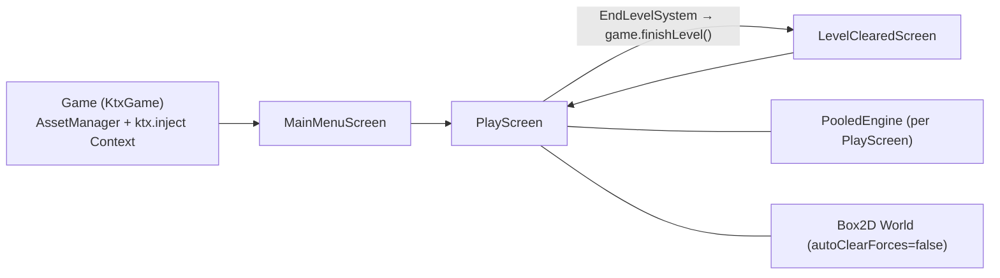

# Star Trap: Technical Architecture

Status: describes the code as of 2026-11-01 (branch `stack-update`). Keep this file current when the architecture changes. Agents read it before coding.

## Stack

| Area | Choice |
|---|---|
| Language | Kotlin 2.4 (JVM toolchain 25, auto-provisioned via foojay) |
| Framework | libGDX 1.14.2, KTX 1.14.2-rc2 (`app`, `ashley`, `box2d`, `inject`, `scene2d`, `math`, `log`, `graphics`, `i18n`, `preferences`) |
| ECS | Ashley 1.7.4 (`PooledEngine`) |
| Physics | Box2D (gdx-box2d), fixed step 1/45 s |
| Build | Gradle 9.8.1, Kotlin DSL, version catalog `gradle/libs.versions.toml`, convention plugin `build-logic/src/main/kotlin/kotlin-jvm.gradle.kts` |
| Tests | JUnit 6 (Jupiter) + mockito-kotlin. Test classpath has `assets/` and desktop natives |
| Modules | `core` (all logic), `lwjgl3` (desktop launcher, construo packaging), `teavm` (experimental web), `tool` (texture packer) |

## Runtime structure

Singletons registered in `Game.create()` and fetched with `game.get<T>()`: `GameState`, `OrthographicCamera`, `GameEventManager`, `SpriteBatch`, `TextureAtlas` (textures), `Skin`, `I18NBundle`, `Viewport` (`FitViewport` 48×27 world units), `Stage`, `AssetManager`, `MapProvider`, `BackgroundProvider`, and the screens.

## ECS system order

Systems are registered in `PlayScreen.setupEcs()`. **Registration order is execution order.**

| # | System | Responsibility |
|---|---|---|
| 1 | `EndLevelSystem` | No asteroids left → `game.finishLevel()` |
| 2 | `PlayerInputSystem` | Input listener → `MoveComponent.thrusters/targetAngleRad` (null = not steered), `WeaponComponent.doAttack` |
| 3 | `MoveSystem` | Applies thrust force, once per frame (`moveForcesApplied`) |
| 4 | `WeaponSystem` | Cooldown, spawns projectiles via `WeaponProjectileProvider` |
| 5 | `ContactSystem` | Box2D `ContactListener`: projectile damage into `HealthComponent` |
| 6 | `PhysicsSystem` | Accumulator stepping (max 5 steps/frame). Before each substep applies the `ShipRotationController` angular impulse for entities with `targetAngleRad`. Then `clearForces` and interpolation of transforms |
| 7 | `CameraSystem` | Follows player (clamped to map), mouse wheel zoom 0.5–2 |
| 8 | `WrapSystem` | Teleports `WrapComponent` bodies to the opposite edge |
| 9 | `RenderSystem` | Background + sprites, using interpolated transforms |
| 10 | `DebugSystem` | (only when `IS_DEBUG`) Box2D debug renderer |
| 11 | `HudSystem` | scene2d HUD |
| 12 | `MinimapSystem` | ShapeRenderer dots per entity |
| 13 | `DeathSystem` | health ≤ 0 → asteroid split, add `RemoveComponent` |
| 14 | `RemoveSystem` | Out-of-bounds tagging, destroys bodies, removes entities |

## Components (`core/.../component/`)

`BaseInfoComponent` (id, faction, `EntityType`; every entity has one), `BodyComponent` (Box2D body, `moveForcesApplied`), `TransformComponent` (prev + interpolated position/rotation), `SpriteComponent`, `MoveComponent` (thrusters −1..1, `targetAngleRad` world angle or null), `WeaponComponent`, `ProjectileComponent` (sealed projectile types, currently `LaserProjectile`), `HealthComponent`, `AsteroidComponent`, `PlayerComponent`, `WrapComponent`, `RemoveComponent`.

The convention is described in `CLAUDE.md`: a `Poolable` class, `xxxMapper`, and `Entity.xxxCmp`/`xxxCmpOptional`.

## Physics loop details

- `PHYSICS_UPDATE_INTERVAL = 1/45 s`, velocity iterations 6, position iterations 2.
- `autoClearForces = false`. `MoveSystem` applies thrust only while `moveForcesApplied == false`, then sets it to true. `PhysicsSystem.preProcess()` resets the flag before each step, and `world.clearForces()` runs only after a frame that actually stepped. The result is that the force applied once per frame persists through every sub-step of that frame, and frames with zero steps don't double-apply it. **Revisit this when relativistic dynamics replace the force model.** At that point it's simpler to apply forces inside the step loop, through a per-step hook.
- **Rotation (ST-004):** `PlayerInputSystem` writes the world angle to `MoveComponent.targetAngleRad`. `ShipRotationController` is a PD controller (kp 80, kd 2√kp, acceleration clamp ±200 rad/s², angular velocity cap 2π rad/s). `PhysicsSystem` turns its output into an angular impulse before **every** `world.step`, so it stays correct with several substeps per frame. Entities with a null `targetAngleRad` are not rotated. Angle error uses `shortestAngleDiffRad`, so the ship always turns the short way.
- **Box2D speed cap:** `b2_maxTranslation = 2.0` units per step, so the effective max speed is **90 u/s** at 45 Hz. `SPEED_OF_LIGHT = 250` (in `physics/PhysicsConstants.kt`) is above that, so projectiles that are meant to move at c are silently clamped. Any relativity design must pick `c` below about 80 u/s, or change the step rate or unit scale.
- Units: 1 world unit = 18 px (`UNIT_SCALE`). The map is 100×100 units. The view is 48×27 units at zoom 1.

## Collision filtering

`FactionEnum` (`PLAYER`, `NEUTRAL`, `ENEMY`). `ownCategoryBit` is the faction's own bit and is set as the fixture's `categoryBits`. `collidesWithMask` holds the bits the faction collides with and is set as `maskBits`. `FactionEnum.collidesWith(other)` checks the symmetric rule.

## Known issues and tech debt

These are input for the backlog. Card IDs are given where a card exists.

1. **Wrap teleport is confusing.** It's planned to be replaced by a boundary force field. → milestone M2
2. **Minimap**: `MinimapSystem` calls `shape.begin/end` per entity, inside a `SpriteBatch.use` block, and never sets `shape.projectionMatrix` to the minimap camera. It has no frame, no background and no camera rectangle.
3. **Star field**: three full-screen layers that scroll on a timer, independent of camera movement. There's no parallax from player motion and the contrast is low.
4. `PlayScreen.hide()` only removes player entities. Asteroids, projectiles and Box2D bodies leak between levels (there's a TODO).
5. ~~`WeaponProjectileProvider` sets `filter.categoryBits` twice and never sets `maskBits`.~~ Fixed in ST-007.
6. `BaseInfoComponent.reset()` doesn't reset `entityType`. The global id counter is a static mutable.
7. `AsteroidSize.SMALL` uses the `asteroid_big` texture.
8. CI (`.github/workflows/workflows.yaml`) still installs JDK 17. The toolchain is 25, so it relies on foojay provisioning.
9. `CLAUDE.md` used to describe a Groovy build on JDK 17. That's fixed, but verify after any build change.

## Testing strategy

- Pure logic (math, relativity formulas, angle wrapping, force fields) lives in small top-level functions or objects, with no GL context needed, and is unit tested directly.
- Systems are tested with mocked `Body` or a real `World` (natives are on the test classpath). See `MoveSystemTest`, `WeaponProjectileProviderTest`.
- Rendering and shaders can't be unit tested. Cards that touch them carry a `playtest:` line, and a human checks those visually.

## Planned architecture (see `docs/design/game-design.md` and `docs/research/relativity-effects.md`)

- **Relativistic dynamics layer**: our own integration of momentum and proper time per entity, writing velocities into Box2D. Box2D keeps collision detection and response.
- **Observer-frame rendering**: render the scene to an FBO, then run post-process shaders (aberration, Doppler/searchlight, lensing). Per-sprite shaders handle effects that belong to one object (length contraction, Terrell-like distortion).
- **Arena boundary field**: a radial or edge-distance repulsive force applied in a dedicated system before the physics step. It replaces `WrapSystem`.
