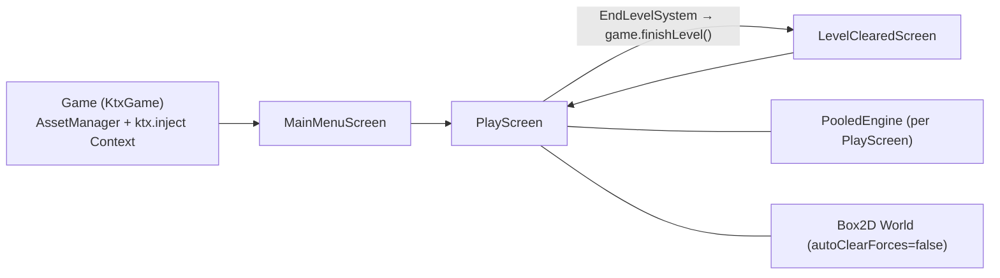

# Star Trap: Technical Architecture

Status: describes the code as of 2026-11-01 (branch `AI-slop`, after M1). Keep this file current when the architecture changes. Agents read it before coding.

## Stack

| Area | Choice |
|---|---|
| Language | Kotlin 2.4 (JVM toolchain 25, auto-provisioned via foojay) |
| Framework | libGDX 1.14.2, KTX 1.14.2-rc2 (`app`, `ashley`, `box2d`, `inject`, `scene2d`, `math`, `log`, `graphics`, `i18n`, `preferences`) |
| ECS | Ashley 1.7.4 (`PooledEngine`) |
| Physics | Box2D (gdx-box2d), fixed step 1/`PHYSICS_TICK_RATE` s (60 Hz) |
| Build | Gradle 9.8.1, Kotlin DSL, version catalog `gradle/libs.versions.toml`, convention plugin `build-logic/src/main/kotlin/kotlin-jvm.gradle.kts` |
| Tests | JUnit 6 (Jupiter) + mockito-kotlin. Test classpath has `assets/` and desktop natives |
| Modules | `core` (all logic), `lwjgl3` (desktop launcher, construo packaging), `teavm` (experimental web), `tool` (texture packer) |

## Runtime structure

Singletons registered in `Game.create()` and fetched with `game.get<T>()`: `RandomXS128` (seeded from `LaunchOptions.seed`, or the clock), `GameState`, `OrthographicCamera`, `GameEventManager`, `SpriteBatch`, `TextureAtlas` (textures), `Skin`, `I18NBundle`, `Viewport` (`FitViewport` 48×27 world units), `Stage`, `AssetManager`, `MapProvider`, `BackgroundProvider`, `KeyValueStore` (libGDX `Preferences` `star-trap-settings`; in-memory for screenshot runs), `DisplaySettings` (fullscreen, desktop only), `MenuSettings` (the player-facing settings table in `settings/MenuSettings.kt`, loaded from the store at startup; `--controls` overrides it), and the screens. `Game` takes a `LaunchOptions`, which `Lwjgl3Launcher` parses from the command line.

Input: `Gdx.input.inputProcessor` is `InputMultiplexer(Stage, GameEventManager)`. Stage goes first; `GameEventManager.keyDown` returns `true` only for keys it handles. Keys and mouse buttons come from the `input/InputBindings.DEFAULT` table (`InputAction` → `InputTrigger`), which the main-menu controls list also reads; `GameEventManager` has no key literals. New keys go in that table, never as literals (`keyAction`/`buttonAction` resolve them; the debug panel key F1 is `debugOnly`).

Player settings: `settings/MenuSettings.kt` holds one list of `SettingSpec`s (`Toggle`, `Slider`, `Choice`) that the menu, persistence and "Reset defaults" all iterate. They are saved to libGDX `Preferences` named `PREFERENCES_NAME` (`Config.kt`) through `KeyValueStore`. `Game.create()` loads them after the singletons are bound; screenshot runs (`--screenshot`) use an in-memory store, so nothing is read from or written to the prefs file. Command-line flags win over saved values (`--controls` is applied after loading).

## ECS system order

Systems are registered in `PlayScreen.setupEcs()`. **Registration order is execution order.**

| # | System | Responsibility |
|---|---|---|
| 0 | `TimeWarpSystem` | (ST-069) Pilot clock: fills the shared `GameClock` from the player's `RelativisticComponent.gUsed` (`warp = γ` capped at `timeWarpMax`, `worldDt = warp·realDt` capped at 10 physics steps). `PhysicsSystem`, `LifetimeSystem` (WORLD clock) and `ObserverSystem` consume `worldDt`/`worldTime`; everything else still sees real (pilot) time |
| 1 | `EndLevelSystem` | No asteroids left → `game.finishLevel()` |
| 2 | `PlayerInputSystem` | Input listener fills `PlayerInputState`, then delegates to the active `ControlStrategy` (selected by `ControlSettings.scheme`, a `ControlScheme`), which writes `MoveComponent.thrusters`/`targetAngleRad` and `WeaponComponent.doAttack`/`aimAngleRad`. `MouseHullStrategy` and `AutoAimStrategy` (ST-062: nearest retarded target in a 90 deg wide cone (±45°) within 40 u, aimed with `leadDirection`) exist; TWIN_STICK falls back to mouse-hull (ST-061) |
| 3 | `MoveSystem` | Step listener, `beforeStep` once per physics step. Bodies with a `RelativisticComponent`: adds `thrustAccelWorld(ENGINE_PROPER_ACCEL·thr, …)` to `RelativisticComponent.accel` (reverse thrust is `REVERSE_THRUST_FRACTION` as strong). Other bodies: Newtonian `applyForceToCenter` |
| 4 | `WeaponSystem` | Cooldown runs on `Entity.properDelta(clock, dt)` (ST-040), spawns projectiles via `WeaponProjectileProvider` |
| 5 | `ContactSystem` | Box2D `ContactListener`: `beginContact` calls top-level `applyProjectileHit(engine, projectile, target)`, which applies damage to `HealthComponent`, sets `ProjectileComponent.spent` and adds `RemoveComponent`. Projectiles are consumed on first hit and no longer pierce; a spent projectile ignores further hits. ST-048 ram damage: for two non-projectile, non-sensor fixtures, `ramDamage(va, vb, m0A, m0B, c)` = `(γrel − 1)·μ·DAMAGE_PER_REST_ENERGY` (0 below `RAM_GAMMA_THRESHOLD`; c cancels) is subtracted from each body's `HealthComponent`, using pre-step `vSet` velocities and `restMass`; the player's share is scaled by `PLAYER_RAM_DAMAGE_FACTOR` (0). Allocation-free (scratch vectors) |
| 6 | `BoundaryFieldSystem` | Physics step listener, passed to `PhysicsSystem`. `beforeStep`: mass-independent repulsive boundary field (`physics/BoundaryField.kt`) as force on dynamic bodies, projectiles are ignored: they leave the arena, leaving one ripple where they cross the wall. `afterStep`: hard backstop (clamp inside, reflect outward velocity), emits shimmer impacts into `ShimmerImpacts` and advances its clock. Lazily fills `BodyComponent.boundingRadius` |
| 7 | `ProjectileSweepSystem` | Registered before `PhysicsSystem` and passed as its third step listener (order: thrust, field, sweep). `afterStep`: for each unspent projectile, `world.rayCast` from `TransformComponent.prevPosition` (start-of-tick position) to the current body position, so fast sensor projectiles can't tunnel through small targets. Ignores own body, sensors and non-colliding factions (`collidesWith`), keeps the nearest hit and calls `applyProjectileHit`. Valid while `PHYSICS_SUBSTEPS = 1`. Known limitation: a projectile reflected by the boundary backstop gets a chord ray from its old position to the post-reflection position (low risk) |
| 8 | `RelativisticDynamics` | Registered right before `PhysicsSystem` and passed as its LAST step listener (order: thrust, field, sweep, relativistic). `beforeStep`: resets non-finite `u`/`accel` to zero, `u += accel·dt`, `clampU` to `gammaMax`, writes `v = u/γ` into the body, remembers `vSet` and `gUsed`. `afterStep`: if the body velocity differs from `vSet` by more than `COLLISION_EPS` (contact, backstop), clamps it to `BETA_MAX_MASSIVE·c` and sets `u = uFromV(v)`; then `tau += dt/gUsed` and clears `accel`. Family `RelativisticComponent` + `BodyComponent` |
| 8b | `LightHistorySystem` | Registered after `RelativisticDynamics`, passed as the LAST step listener (order: thrust, field, sweep, relativistic, light history) and an `EntityListener`. `afterStep`: `time += dt` (= `GameClock.worldTime`), records `(time, x, y, angle, vx, vy)` of every `BodyComponent`+`BaseInfoComponent`+`TransformComponent` entity into a `LightHistory` keyed by `BaseInfoComponent.id`; first seen within one step means `eternal`. `entityRemoved` keeps the history and stores `removedAt`; pruned after `LIGHT_HISTORY_CAPACITY` steps, objects reused via a free list. API: `historyOf(id)`, `removedAt(id)` (NaN while alive), `now`, `clear()` (called in `PlayScreen.show`) |
| 9 | `PhysicsSystem` | Accumulator stepping on `GameClock.worldDt` (max `MAX_STEPS_PER_FRAME` = 10 steps/frame; step test uses a 1e-6 epsilon). Per step: listeners' `beforeStep`, `ShipRotationController` angular impulse for entities with `targetAngleRad`, `world.step`, listeners' `afterStep`, `clearForces`. Transform interpolation runs once per frame |
| 10 | `ObserverSystem` | Fills `physics/ObserverState` from the player once per frame: position, `betaRaw = v/c` (v from `velocityFromU(u)`), `gammaRaw`, `rapidity`, `tau` (from `RelativisticComponent`, else world time), `worldTime`, plus `betaVisual`/`gammaVisual` low-pass filtered with `VISUAL_BETA_SMOOTHING` (`smoothToward`). Owned by `PlayScreen`, reset in `show()` |
| 11 | `CameraSystem` | Follows player (clamped to map plus `FIELD_SKIN / 2` margin), mouse wheel zoom 0.5–2 |
| 12 | `RenderSystem` | Nebula background + `Starfield` (camera-relative parallax), then the reference grid (`render/ReferenceGridRenderer`, ShapeRenderer lines every 20 u, brighter centre axes; toggle `DebugSettings.gridEnabled`), then sprites (interpolated transforms; with `RelativitySettings.pilotView`, default on, V toggles, `render/PilotViewProjector` draws every non-player sprite at its retarded position from `LightHistorySystem` boosted into the pilot frame by `betaVisual`, skips entities whose light has not arrived, and draws the player unboosted at the camera centre; the camera is then unclamped. Physics, minimap and HUD stay in arena coordinates; the grid and boundary band are still drawn in arena coordinates), then the boundary field band via `render/FieldShimmerRenderer` (`assets/shaders/field_shimmer.*`: honeycomb brightening with depth plus ripples expanding at c from `ShimmerImpacts`, additive blend; `u_time` is `ShimmerImpacts.time`; falls back to a pulsing tint if the shader fails to compile). `RenderSystem` is `Disposable` and disposes the renderer |
| 12b | `DebugVectorSystem` | (ST-060) When `DebugSettings.showVectors`: ShapeRenderer arrows from the interpolated position for `v` (green), `u` (cyan) and `RelativisticComponent.lastAccel` (orange), plus a grey c ring around the player. Scales are c-relative (`vectorScales`). `Disposable` |
| 12c | `TacticalOverlaySystem` | (ST-123) Tactical computer: over the sprites, thin ShapeRenderer outlines of every body at its true interpolated arena position (`render/TacticalOverlay.kt` `outlineVertices`, min radius 4 px), arena-frame velocity arrows (`arrowSegments`, `tacticalArrowScale(c)`, none for projectiles) and the arena border. Drawn only when `tacticalOverlayVisible(TacticalSettings.mode, pilotView, player's TacticalComputerComponent.tier, inverted)`. `Disposable` |
| 13 | `DebugSystem` | (only when `IS_DEBUG`) Box2D debug renderer |
| 14 | `DebugPanelSystem` | (ST-059) Refreshes the `ui/DebugPanel` readouts at 10 Hz via `panel.update(observerState, playerRel)`; runs only while the panel is visible. Placed just before `HudSystem` because `HudSystem` acts and draws the stage |
| 15 | `HudSystem` | scene2d HUD; also acts and draws the whole `Stage`, including the debug panel. Also draws edge arrows (`render/EdgePointer`, selection in `render/TargetPointers`) to the 6 nearest off-screen NEUTRAL/ENEMY non-projectile entities (grey/red, alpha fades 0.9 to 0.3 over 120 u) with a distance label on the nearest (toggle `DebugSettings.targetPointersEnabled`) |
| 16 | `MinimapSystem` | Bottom-right minimap (`ui/MinimapViewport`): arena background, entity dots, camera view rectangle, arena border |
| 17 | `LifetimeSystem` | `LifetimeComponent.remaining -= dt`; at 0 adds `RemoveComponent`; fades sprite alpha over the last `LIFETIME_FADE_SECONDS`. WORLD clock uses `GameClock.worldDt`; PROPER clock uses `Entity.properDelta` (ST-040: player real time, other relativistic bodies `worldDt/gUsed`) |
| 18 | `DeathSystem` | health ≤ 0 → asteroid split, add `RemoveComponent` |
| 19 | `RemoveSystem` | Out-of-bounds safety net: bodies beyond the map plus a 20 % margin get `RemoveComponent`, except the player, which is clamped to 1 unit inside the map with velocity zeroed. Destroys bodies, removes entities |

## Debug panel (ST-059)

`ui/DebugPanel` is a scene2d `Table` docked on the right of the `Stage` (260 px, translucent black background from the skin's `white` region). It exists only when `DebugSettings.panelAllowed` (`IS_DEBUG` or `--debug-panel`); `PlayScreen.show` adds it and registers it as a `DebugInputListener` (F1 toggles `panelVisible`, and the cursor swaps between Arrow and Crosshair). Contents: readouts (β, γ, τ, world t, |v|, |u|, ship-frame speed, c, a0; text built by the pure `formatReadouts`), toggles (relativity, boundary field, show vectors), time scale buttons, sliders (c, a0, field damping, γ cap) writing `RelativitySettings`, a control scheme `SelectBox` and "reset defaults". Labels are English literals (developer tooling, no i18n).

## Components (`core/.../component/`)

`BaseInfoComponent` (id, faction, `EntityType`; every entity has one), `BodyComponent` (Box2D body, `boundingRadius` for the boundary field, -1 until computed), `TransformComponent` (prev + interpolated position/rotation), `SpriteComponent`, `MoveComponent` (thrusters −1..1, `targetAngleRad` world angle or null), `WeaponComponent`, `ProjectileComponent` (sealed projectile types, currently `LaserProjectile`; `spent` flag), `PhotonComponent` (ST-039: unit flight direction `dir` of a photon laser after muzzle aberration), `HealthComponent`, `AsteroidComponent`, `PlayerComponent` (mapper and `playerCmpOptional`), `ShipHandlingComponent` (per-ship PD gains, defaults from `ShipRotationController`), `LifetimeComponent` (remaining/total, `LifetimeClock` WORLD or PROPER), `RemoveComponent`, `TacticalComputerComponent` (ST-123: `tier`, gates the tactical overlay; player only), `RelativisticComponent` (ST-037: proper velocity `u`, per-step `accel` accumulator, proper time `tau`, `gUsed`, `vSet`, `gammaMax`; added to the player and all asteroids when `RELATIVITY_ENABLED`).

The convention is described in `CLAUDE.md`: a `Poolable` class, `xxxMapper`, and `Entity.xxxCmp`/`xxxCmpOptional`.

## Physics loop details

- `PHYSICS_UPDATE_INTERVAL = 1/PHYSICS_TICK_RATE` (60 Hz), velocity iterations 6, position iterations 2. `PHYSICS_TICK_RATE` is the one base constant: `C_MAX_BOX2D_SAFE`, `MAX_STEPS_PER_FRAME` (10) and `MAX_LAG_STEPS` (7) derive from it. `TimeWarpSystem` caps the world time per frame at `MAX_LAG_STEPS` intervals at warp 1 and `MAX_STEPS_PER_FRAME` at high warp.
- Once per frame, `preProcess` stores each body's previous position and rotation. After the stepping loop, `interpolateTransforms` lerps `TransformComponent.interpolatedPosition/RotationDeg` with `alpha = accumulator / interval`. Rendering uses only these interpolated values.
- `autoClearForces = false`. `PhysicsSystem` takes a list of `PhysicsStepListener`s (`MoveSystem`, `BoundaryFieldSystem`, `ProjectileSweepSystem`, `RelativisticDynamics`, `LightHistorySystem`, in that order). For every step it runs `beforeStep(dt)` on each listener, then `applyRotation()`, `world.step`, `afterStep(dt)` on each, then `world.clearForces()`. Thrust is applied in `beforeStep`, so it acts once per step. `PHYSICS_SUBSTEPS = 1` splits each step into sub-steps if needed.
- **RelativitySettings (ST-056):** `physics/RelativitySettings` is a mutable singleton in DI (`Game.create` binds it, `PlayScreen` passes it to `MoveSystem`, `RelativisticDynamics`, `BoundaryFieldSystem`, the providers and `FieldShimmerRenderer`). Runtime code reads `c`, `engineProperAccel`, `gammaMaxMassive`, `fieldParams`/`fieldDamping` and the switches `relativityEnabled` / `fieldEnabled` from it; the consts in `PhysicsConstants.kt` are only defaults. Setters clamp (`c` to `[C_MIN, C_MAX_BOX2D_SAFE]`). Providers always attach `RelativisticComponent`; with `relativityEnabled = false` `MoveSystem` uses Newtonian force and `RelativisticDynamics` keeps `u` synced from the body velocity. With `fieldEnabled = false` only the hard backstop acts. Changing `c` mid-flight keeps `u`; photons in flight keep their speed until they bounce.
- **Relativistic mass in collisions (ST-047):** with `RelativitySettings.gammaMassEnabled` (default `GAMMA_MASS_ENABLED`) and relativity on, `RelativisticDynamics.beforeStep` sets the Box2D mass and inertia to `min(γ, GAMMA_MASS_CAP = 8)·` the rest values (`RelativisticComponent.restMass/restInertia`, captured by the providers; `massGamma` is the γ currently applied, updated only when it changes by more than 1 %, via one reused `MassData`). Box2D contacts then conserve `Σ γ m v`, and the `afterStep` readback is `u = gUsed·v` (clamped) instead of `uFromV`. Relativity off restores the rest mass. Thrust and the field are accelerations and the PD rotation controller applies `inertia·Δω`, so none of them depend on the mass; the debug panel mass readout shows the current Box2D mass. Lie row 8 in `physics-lies.md`.
- **Relativistic integration (ST-037):** contributors add proper accelerations into `RelativisticComponent.accel` during `beforeStep`, and `RelativisticDynamics` (last) integrates `u` and writes `v = u/γ` into Box2D, so Box2D only does collisions. `afterStep` reads back any contact-changed velocity into `u`. The boundary field (ST-038) adds its acceleration to `accel` with damping on `u`, and its backstop reflects `u` and sets `vSet`, so relativistic bodies get no direct Box2D forces. Forces applied directly to a relativistic body would change its velocity during the step; `afterStep` picks that up only when the change exceeds `COLLISION_EPS` (0.05 u/s per step, i.e. accelerations above `COLLISION_EPS × tick rate`, about 3 u/s² at 60 Hz), smaller pushes are lost. The angular impulse stays Newtonian, but `PhysicsSystem.applyRotation` scales the PD gains by the clock factor `f` (`Entity.rotationTimeFactor`: `1/warp` for the player, `1/gUsed` for other relativistic bodies), and `RelativisticDynamics.beforeStep` rescales free spin (no `targetAngleRad`) by `gUsedPrev/g` (ST-040).
- **Rotation (ST-004):** `PlayerInputSystem` writes the world angle to `MoveComponent.targetAngleRad`. `ShipRotationController` is a PD controller (kp 80, kd 2√kp, acceleration clamp ±200 rad/s², angular velocity cap 2π rad/s). `PhysicsSystem` turns its output into an angular impulse before **every** `world.step`, so it stays correct with several substeps per frame. Entities with a null `targetAngleRad` are not rotated. Angle error uses `shortestAngleDiffRad`, so the ship always turns the short way.
- **Box2D speed cap:** `b2_maxTranslation = 2.0` units per step, so the hard cap is `2 × tick rate` (120 u/s at 60 Hz) and the safe limit `C_MAX_BOX2D_SAFE = 0.75 × 2 × tick rate` is **90 u/s**. `SPEED_OF_LIGHT = 20` (in `physics/PhysicsConstants.kt`) sits well under it. `ENGINE_PROPER_ACCEL` derives from c (`c·γβ(0.9)/5 s`, about 8.26), and `ASTEROID_SPAWN_BETA_MAX` is a fraction of c.
- Units: 1 world unit = 18 px (`UNIT_SCALE`). The map is 200×200 units (field skin 10 u). The view is 48×27 units at zoom 1.
- **Boundary field (`BoundaryFieldSystem`):** the field acts on bodies before each step, and the hard backstop runs after it. Constants are in `physics/BoundaryField.kt`.

## Collision filtering

`FactionEnum` (`PLAYER`, `NEUTRAL`, `ENEMY`). `ownCategoryBit` is the faction's own bit and is set as the fixture's `categoryBits`. `collidesWithMask` holds the bits the faction collides with and is set as `maskBits`. `FactionEnum.collidesWith(other)` checks the symmetric rule.

## Known issues and tech debt

These are input for the backlog. Card IDs are given where a card exists.

1. `BaseInfoComponent.reset()` doesn't reset `entityType`. The global id counter is a static mutable. (No card yet.)
2. Boundary backstop vs. contacts (ST-038): `BoundaryFieldSystem.afterStep` runs before `RelativisticDynamics.afterStep`, so if a contact changes a relativistic body's velocity in the same step as a backstop hit, the backstop reflects the stale `u` and the contact change is lost. Judged very rare (the field repels strongly there). (No card.)

Fixed in M1 and removed from this list: ST-006 (level cleanup in `hide()`), ST-007 (faction filter bits), ST-008 (small asteroid texture), ST-009 (CI on JDK 25), ST-011 (minimap rework), ST-012 (starfield).

## Testing strategy

- Pure logic (math, relativity formulas, angle wrapping, force fields) lives in small top-level functions or objects, with no GL context needed, and is unit tested directly.
- Systems are tested with mocked `Body` or a real `World` (natives are on the test classpath). See `MoveSystemTest`, `WeaponProjectileProviderTest`.
- Rendering and shaders can't be unit tested. Cards that touch them carry a `playtest:` line, and a human checks those visually.

## Planned architecture (see `docs/design/game-design.md` and `docs/research/relativity-effects.md`)

- **Relativistic dynamics layer**: our own integration of momentum and proper time per entity, writing velocities into Box2D. Box2D keeps collision detection and response.
- **Observer-frame rendering**: render the scene to an FBO, then run post-process shaders (aberration, Doppler/searchlight, lensing). Per-sprite shaders handle effects that belong to one object (length contraction, Terrell-like distortion).
- **Arena boundary field**: implemented as `BoundaryFieldSystem` (see the system table). It replaced the old wrap teleport.
