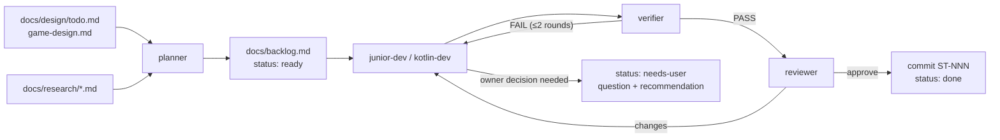

# Agent-driven development workflow

Star Trap is developed mostly by Claude Code subagents, and the owner gives as little input as possible. This file explains the setup.

## The team (`.claude/agents/`)

| Agent | Model / effort | Role | Writes |
|---|---|---|---|
| `planner` | Opus / medium | Roadmap + research → small, ordered task cards, routed to the cheapest capable agent | `docs/backlog.md` |
| `kotlin-dev` | Sonnet / medium (orchestrator may raise it) | Implements size-M cards: systems, components, algorithms, shaders, with tests | code + tests |
| `junior-dev` | Haiku / low | Size-S mechanical cards with an exact spec | code, config, docs |
| `verifier` | Haiku / low | Runs Gradle build and tests, reports failures with file:line. Read-only | — |
| `reviewer` | Sonnet / medium | Reviews the diff against the card, project invariants and physics. Read-only | — |
| `physics-researcher` | Opus / high | Relativity, gravity and force-field physics → game-ready specs with formulas, cost and verdicts | `docs/research/*.md` |

Most of the volume goes to Haiku and Sonnet. Opus is used only for planning and physics research, which happen rarely and where mistakes cost the most.

## Skills (`.claude/skills/`)

- **`/auto-dev [N | ST-xxx]`**: the orchestrator loop. It picks a ready card → the implementer → verifier → (reviewer for M) → commits `ST-NNN: title` on the `AI-slop` branch → updates the card. At the end it reports a playtest checklist and open questions. To run it unattended: `/loop /auto-dev 3`.
- **`/plan-backlog <idea | research doc>`**: has the planner turn something into cards.

## Lifecycle of a card

## Where the owner comes in

1. **Questions**: `needs-user` cards, and §11 of `docs/design/game-design.md`. Each one has a recommendation, so a reply like "go with the recommendations" is enough.
2. **Playtests**: each `/auto-dev` run ends with a checklist from the `playtest:` lines. Run `./gradlew lwjgl3:run`.
3. **New wishes**: add them to `docs/design/todo.md` (in any form). The planner picks them up when the backlog runs dry, or right away with `/plan-backlog`.

## Conventions for agents

- Read `CLAUDE.md`, `docs/tech/architecture.md` and `docs/tech/ktx-cheatsheet.md` first.
- One card per commit, on the `AI-slop` branch only. Never commit to `master` or `stack-update`, and never push.
- Pure logic is pulled out and unit tested. GL code stays thin.
- If a card changes the architecture, `docs/tech/architecture.md` is updated in the same commit.

## Visual checks

Planned in ST-005. A screenshot harness (`./gradlew lwjgl3:run --args="--screenshot=/abs/path.png --frames=120"`) will let agents render a frame and inspect the PNG with their image-reading tool, for minimap, starfield and shader work. This section will be completed when ST-005 lands.

## Optional: IntelliJ MCP

`.mcp.json` registers the IntelliJ MCP server (`idea`). When the IDE is running, agents can use `mcp__idea__get_file_problems` for Kotlin inspections, since the project has no CLI linter. Gradle remains the source of truth.
