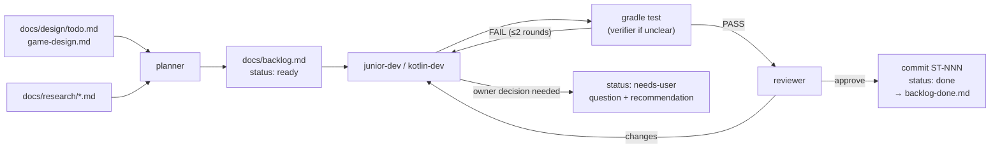

# Agent-driven development workflow

Star Trap is developed mostly by Claude Code subagents, and the owner gives as little input as possible. This file explains the setup.

## The team (`.claude/agents/`)

| Agent | Model / effort | Role | Writes |
|---|---|---|---|
| `planner` | Opus / medium | Roadmap + research → small, ordered task cards, routed to the cheapest capable agent | `docs/backlog.md` |
| `kotlin-dev` | Sonnet / medium (orchestrator may raise it) | Implements size-M cards: systems, components, algorithms, shaders, with tests | code + tests |
| `junior-dev` | Haiku / low | Size-S mechanical cards with an exact spec | code, config, docs |
| `verifier` | Haiku / low | Finds the root cause of unclear build/test failures, with file:line. Read-only. `/auto-dev` runs Gradle itself and spawns it only when needed | — |
| `reviewer` | Sonnet / medium | Reviews the diff against the card, project invariants and physics. Read-only | — |
| `physics-researcher` | Opus / high | Relativity, gravity and force-field physics → game-ready specs with formulas, cost and verdicts | `docs/research/*.md` |

Most of the volume goes to Haiku and Sonnet. Opus is used only for planning and physics research, which happen rarely and where mistakes cost the most.

## Skills (`.claude/skills/`)

- **`/auto-dev [N | ST-xxx]`**: the orchestrator loop. It picks a ready card (`scripts/backlog.py next`) → the implementer → Gradle build → (reviewer for M) → commits `ST-NNN: title` on the `AI-slop` branch → marks the card done and archives it to `docs/backlog-done.md`. At the end it reports a playtest checklist and open questions. To run it unattended: `/loop /auto-dev 3`.
- **`/plan-backlog <idea | research doc>`**: has the planner turn something into cards.

## Lifecycle of a card



## Where the owner comes in

1. **Questions**: `needs-user` cards, and §11 of `docs/design/game-design.md`. Each one has a recommendation, so a reply like "go with the recommendations" is enough.
2. **Playtests**: each `/auto-dev` run ends with a checklist from the `playtest:` lines. Run `./gradlew lwjgl3:run`.
3. **New wishes**: add them to `docs/design/todo.md` (in any form). The planner picks them up when the backlog runs dry, or right away with `/plan-backlog`.

## Conventions for agents

- `CLAUDE.md` is loaded automatically. Read only the doc sections a card names on its `refs:` line, plus the parts of `docs/tech/architecture.md` that cover the code you touch.

## Saving tokens

- `docs/backlog.md` holds only open cards; finished ones are in `docs/backlog-done.md`. Nobody reads either file in full: `scripts/backlog.py next | show ST-NNN | list | archive [ST-NNN]`.
- Cards carry a `refs:` line naming the doc sections the implementer needs, so nobody reads all of `docs/research/relativity-effects.md`.
- The orchestrator runs Gradle itself; the verifier agent is only for unclear failures.
- Trivial review findings are fixed in the same round; the rest of a card's follow-ups go into one card.
- One card per commit, on the `AI-slop` branch only. Never commit to `master` or `stack-update`, and never push.
- Pure logic is pulled out and unit tested. GL code stays thin.
- If a card changes the architecture, `docs/tech/architecture.md` is updated in the same commit.

## Visual checks

Agents can render the game headlessly-ish (a display is needed) and inspect the result with the image-reading tool:

```bash
./gradlew lwjgl3:run --args="--screenshot=/abs/path/st.png --frames=120"
```

Options (parsed by `parseLaunchOptions` in `core/.../debug/ScreenshotHarness.kt`):

- `--screenshot=<path.png>`: enables the harness. Use an absolute path, because the run task's working dir is `assets/`.
- `--frames=<N>`: frames to render before capturing (default 180).
- `--scene=play|menu`: `play` skips the main menu (default), `menu` stays on it.
- `--thrust`: hold the thrusters during the run.
- `--seed=<long>`: seeds all gameplay randomness (one `RandomXS128` in the DI context). Without it the seed comes from the clock. Screenshot runs also use a fixed 1/60 s frame delta, so the same args give byte-identical PNGs.
- `--near-asteroids=<n>`: additionally places n large asteroids in a ring 8-15 u around the player (seeded RNG), so near-field effects such as the pilot view are visible on level 1.

No player input is sent otherwise. After frame N the framebuffer is saved as PNG and the app exits by itself. Wrap the command in `timeout 120` to be safe. Unknown flags and invalid values are ignored.

## Optional: IntelliJ MCP

`.mcp.json` registers the IntelliJ MCP server (`idea`). When the IDE is running, agents can use `mcp__idea__get_file_problems` for Kotlin inspections, since the project has no CLI linter. Gradle remains the source of truth.
